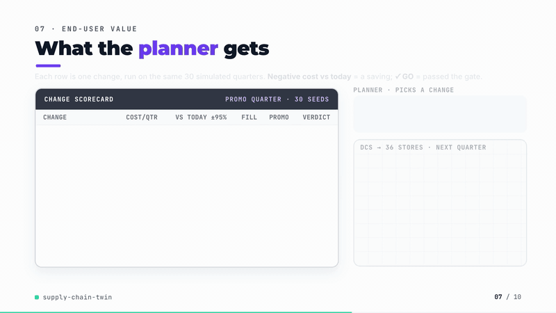
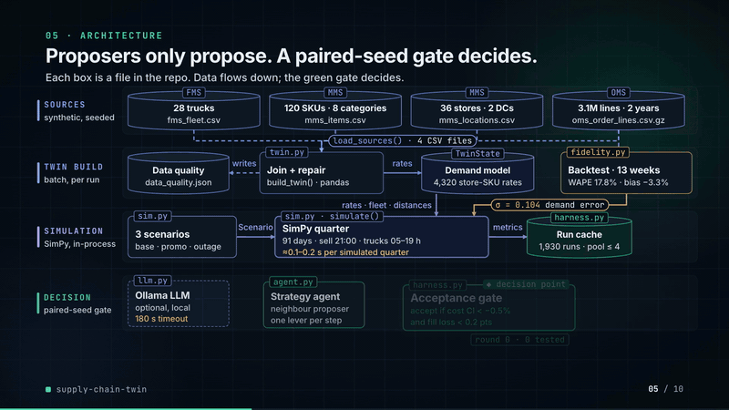

# supply-chain-twin

[](https://github.com/kavya2693/supply-chain-twin/actions/workflows/ci.yml)


Test replenishment, promotion and fleet-size changes on a digital twin of a retail chain
before they reach a single store, and accept only the ones that beat the current policy by
more than the twin's own error.

[](https://kavya2693.github.io/work-demos/supply-chain-twin.mp4)

*~90-second silent walkthrough. [Play the full video](https://kavya2693.github.io/work-demos/supply-chain-twin.mp4) · [download the MP4, 6 MB](docs/demo/demo.mp4).*

📄 **Audit report:** every figure and assumption in the video, traced to its source — [PDF](docs/demo/AUDIT_REPORT.pdf) · [Word](docs/demo/AUDIT_REPORT.docx) · [Markdown](docs/demo/AUDIT_REPORT.md)

## At a glance

| | |
|---|---|
| **Problem** | A retail chain with 2 DCs, 36 stores and about 26 dispatchable trucks keeps being offered cheaper-looking changes: order every two days, stock up with the promotion calendar, hand back trucks. Trying one for real costs a quarter of empty shelves or overflowing backrooms, and the data to judge it is split across fleet, merchandise and order systems. |
| **Approach** | Join the three sources (3.1M order lines, two years) into a twin, play out a 91-day quarter in SimPy, and compare every strategy with the current policy on the same 30 seeds. A change is accepted only if the whole 95% interval of its cost change is below -0.5% of baseline and fill rate drops by no more than 0.2 points. A neighbour search (or an optional local LLM) proposes; the harness decides. |
| **Result** | Ordering every two days alone: **-142,008 ±3,375 per quarter** (about 6%), trucks leave 78% full instead of 65%. The searched plan: **-16.6% total cost** (-407,200) on 30 hold-out seeds of the quarter it was tuned on. Twin backtest: **17.8% weekly store x SKU WAPE** against 24.5% and 29.1% for two naive references. |
| **What didn't win** | The searched plan fails off its tuning scenario: with 20% of the fleet out of service it costs **+63,322** and loses **1.88 points** of fill rate, and in a normal quarter it breaks the fill limit (-0.21 pts). The high-service policy has the best fill rate and loses 156,497. The language-model proposer has no live measurement; it timed out on this machine. |

## Architecture

```mermaid
flowchart LR
    subgraph SRC["Sources"]
        GEN["Seeded generator<br/>scripts/generate_data.py"]
        FMS[("fms_fleet.csv<br/>28 trucks")]
        ITM[("mms_items.csv<br/>120 SKUs")]
        LOC[("mms_locations.csv<br/>36 stores, 2 DCs")]
        OMS[("oms_order_lines.csv.gz<br/>3.1M lines")]
    end

    subgraph FEAT["Data and features"]
        LOAD["Loader<br/>twin.load_sources"]
        CAL["Holiday calendar<br/>calendar.py"]
        JOIN["Join, repair, count defects<br/>twin.build_twin"]
        DQ[("data_quality.json")]
    end

    subgraph MOD["Models"]
        STATE["Twin state: base rates, weekday,<br/>month, holiday, promo multipliers,<br/>NB dispersion<br/>twin.TwinState"]
        FID["13-week hold-out backtest<br/>fidelity.backtest"]
        SIM["SimPy quarter: stores, DC dispatch,<br/>trucks in shift<br/>sim.simulate"]
    end

    subgraph DEC["Decision and optimiser"]
        NB["Neighbour proposer<br/>agent.NeighbourProposer"]
        LLM["Optional LLM proposer<br/>llm.LLMProposer"]
        SNAP["Snap to parameter grid<br/>agent.snap"]
        SEARCH["Search loop, Bonferroni per round<br/>agent.search"]
    end

    subgraph EVAL["Evaluation"]
        HARN["Paired-seed runner + cache<br/>harness.Evaluator"]
        RULE["Acceptance rule<br/>harness.Comparison"]
        ROB["Hold-out seeds + every scenario<br/>cli.cmd_robustness"]
        SCEN["Scenarios: base, promo, fleet_outage<br/>sim.SCENARIOS"]
    end

    subgraph OUT["Outputs"]
        CLI["One-command run<br/>cli.main"]
        RES[("outputs/<br/>strategy_table.csv<br/>search_*.csv, search_*.json<br/>fidelity.json")]
    end

    GEN --> FMS & ITM & LOC & OMS
    FMS --> LOAD
    ITM --> LOAD
    LOC --> LOAD
    OMS --> LOAD
    LOAD -->|"4 DataFrames"| JOIN
    CAL -->|"holiday and eve flags"| JOIN
    JOIN -->|"repair counts"| DQ
    JOIN -->|"rates, costs, distances, fleet"| STATE
    LOAD -->|"history minus 91 days"| FID
    FID -->|"error sigma 0.104"| SIM
    STATE --> SIM
    SCEN -->|"promo window, trucks down"| SIM
    NB -->|"one grid step per lever"| SNAP
    LLM -->|"JSON candidates"| SNAP
    LLM -.->|"timeout or bad JSON: fall back"| NB
    SNAP -->|"Strategy"| SEARCH
    SEARCH -->|"candidate vs incumbent"| HARN
    HARN -->|"strategy, scenario, seed"| SIM
    SIM -->|"cost, fill, utilisation per run"| HARN
    HARN -->|"paired differences, 95% CI"| RULE
    RULE -.->|"accepted: new incumbent"| SEARCH
    RULE -.->|"history of results"| LLM
    SEARCH -->|"final plan"| ROB
    ROB --> HARN
    FID -->|"WAPE, bias"| CLI
    RULE -->|"every comparison"| CLI
    ROB -->|"verdict per scenario"| CLI
    CLI -->|"writes"| RES

    classDef data fill:#7fa8ff,stroke:#3d6fd9,color:#0b1020
    classDef model fill:#b9a2ff,stroke:#7a5fd6,color:#0b1020
    classDef decision fill:#3fd8a8,stroke:#1f9c76,color:#0b1020
    classDef evaluation fill:#f2c46d,stroke:#b8902f,color:#0b1020
    classDef risk fill:#ff8a73,stroke:#cc5640,color:#0b1020

    class GEN,FMS,ITM,LOC,OMS,LOAD,CAL,JOIN,DQ,CLI,RES data
    class STATE,FID,SIM model
    class NB,SNAP,SEARCH decision
    class HARN,RULE,ROB evaluation
    class LLM,SCEN risk
```





Solid edges are the data flow of one run; dotted edges are the feedback and fallback paths.
Red nodes are where risk enters: the untrusted language-model proposer, and the scenarios
(the fleet outage above all) that the search is not tuned on.

### Components

| Component | Responsibility | File |
|---|---|---|
| Data generator | Two years of daily order lines with promotions, holidays, growth and planted defects; fleet, item and location masters | [`scripts/generate_data.py`](scripts/generate_data.py) |
| Calendar | History window and public holidays, with the stock-up day before each | [`src/supply_twin/calendar.py`](src/supply_twin/calendar.py) |
| Twin builder | Loads the four source files, repairs and counts defects, estimates rates, multipliers, promotion uplift and dispersion | [`src/supply_twin/twin.py`](src/supply_twin/twin.py) |
| Fidelity backtest | Builds the twin 91 days early, scores it against unseen order lines and two naive references, measures the error spread fed to the simulator | [`src/supply_twin/fidelity.py`](src/supply_twin/fidelity.py) |
| Simulator | SimPy quarter: evening sales, order-up-to review, shift-bound dispatch with trucks as tokens; strategies, scenarios, cost accounting | [`src/supply_twin/sim.py`](src/supply_twin/sim.py) |
| Evaluation harness | Paired-seed comparisons, t-intervals, the acceptance rule, run cache, process pool | [`src/supply_twin/harness.py`](src/supply_twin/harness.py) |
| Strategy agent | Parameter grid, neighbour proposer, search loop with Bonferroni, hold-out confirmation | [`src/supply_twin/agent.py`](src/supply_twin/agent.py) |
| LLM proposer | Optional Ollama proposer: prompt from results so far, JSON parsing, grid snapping, fallback to neighbours | [`src/supply_twin/llm.py`](src/supply_twin/llm.py) |
| Orchestrator | `supply-twin quality / fidelity / evaluate / search / all`, writes everything in `outputs/` | [`src/supply_twin/cli.py`](src/supply_twin/cli.py) |

### Design decisions

| Decision | Options considered | Chosen | Trade-off |
|---|---|---|---|
| Simulation engine | AnyLogic or another commercial twin tool; per-SKU agents; SimPy with each store's SKUs as one vector | SimPy, store-level processes, trucks as tokens in a per-DC store with a shift window ([ADR-0001](docs/adr/0001-paired-seeds-and-a-practical-floor-decide-strategies.md)) | A quarter runs in about 0.1-0.2 s, so many seeds per strategy are affordable; the price is no intra-day sales timing and no load building by SKU |
| How strategies are compared | Independent seeds per strategy; common random numbers with paired differences | Paired: demand depends only on seed and scenario, never on the strategy | Run-to-run noise mostly cancels, but intervals then measure demand noise, not structural error in the twin |
| What counts as a win | Statistical significance alone; significance plus a practical floor | Whole 95% cost interval below -0.5% of baseline, fill loss no more than 0.2 points | Tiny "significant" gains inside the twin's 3.3% bias are refused; the 0.5% itself is a judgement, recorded so it can be argued with |
| Multiple testing in the search | No correction; Bonferroni per round | Bonferroni across the candidates of each round | Conservative, and in practice changed nothing because paired intervals are so tight; the floor does the real filtering |
| Who picks the policy | Let a language model choose; model proposes, harness judges | Proposers (neighbour or LLM) only propose; values are snapped to a fixed grid; only the harness moves the incumbent | Reproducible and checkable, but the search can only reach plans on the grid |
| Forecast error in simulated demand | A chosen spread; the spread measured in a backtest | Measured: sigma 0.104 from the 13-week hold-out | The twin is exactly as wrong in simulation as in history, but only as wrong as this history can show |
| Joins | PySpark; pandas and numpy in memory | pandas and numpy | Three million lines fit comfortably and CI needs no JVM; a much larger extract would need the joins pushed into a warehouse |

### Data contracts

| Stage | Input | Output |
|---|---|---|
| Sources to loader | Four files in `data/` | `fms_fleet.csv`: `truck_id, home_dc, truck_type` (str), `capacity_cases` (float, nullable), `cost_per_km, daily_fixed_cost` (float), `status` (str); `mms_items.csv`: `sku_id, category` (str), `unit_cost` (float, nullable), `unit_price` (float), `case_pack` (int); `mms_locations.csv`: `store_id, dc_id, size_tier` (str), `distance_km, backroom_cases` (float); `oms_order_lines.csv.gz`: `order_date` (date), `store_id, sku_id` (str), `units` (int), `on_promo` (bool), non-zero lines only |
| Twin builder | `Sources` (four DataFrames), `cutoff` date | `TwinState`: `base_rate` (store x SKU, units per day), `weekday_idx` (7) and `month_idx` (12) per category, `holiday_factor, eve_factor` (float), `promo_uplift` per category, `dispersion` (negative-binomial k), per-store `store_dc, distance_km, backroom_cases`, per-SKU `unit_cost, unit_price, case_pack`, dispatchable `fleet` frame; repair counts to `data_quality.json` |
| Fidelity | `Sources`, 91-day hold-out | `Fidelity`: weekly WAPE at store x SKU and store x category and in promotion weeks, total bias, per reference (`twin, recent_8wk_mean, same_day_last_year`), `rate_error_sigma` (float); `fidelity.json` |
| Simulator | `TwinState`, `Strategy` (`z` float, `review_days` int, `cover_days` float, `extra_trucks` int, `promo_aware` bool), `Scenario` (`horizon_days, promo_categories, promo_start_day, promo_days, trucks_down_share, rate_error_sigma`), `seed` | `RunResult.metrics()`: `fill_rate, promo_fill_rate, total_cost, operating_cost, holding_cost, overflow_cost, transport_cost, fleet_fixed_cost, lost_margin, truck_utilisation, load_fill, late_loads` (float) |
| Harness | candidate and baseline `Strategy`, `Scenario`, seeds, alpha | `Comparison`: `cost_diff, fill_diff, util_diff` as (mean, low, high), `p_value, alpha, baseline_cost`, `accepted` (bool) |
| Search and robustness | start `Strategy`, scenario, 20 search seeds, 30 hold-out seeds | `search_neighbour_promo.csv` (one row per candidate: `round, incumbent, candidate, cost_diff, cost_diff_low, cost_diff_high, fill_diff_pts, ..., accepted, chosen`), `search_neighbour_promo.json` (summary and hold-out), `search_neighbour_promo_robustness.csv` (one row per scenario with final fill, utilisation and late loads) |

### Failure modes and fallbacks

| Failure | What the code does |
|---|---|
| Order feed missing for a store-day (160 store-days here) | A store-day with no lines at all is read as an outage, not zero sales: it is marked unobserved and left out of every rate, multiplier and dispersion estimate, and the count goes to `data_quality.json`. |
| Bad or incomplete master data | A missing landed cost is imputed from the category's median cost-to-price ratio; a missing truck capacity from the median of its truck type; trucks in maintenance or retired are dropped; order lines with an unknown store or SKU are dropped. Each repair is counted, never silent. |
| Outlier orders | Bulk business buys above 1.5x the store-SKU 99.5th percentile (+5) are clipped, so one large order does not set a reorder point; 2,735 cells were clipped. |
| Fleet short or broken down | A load waits for a free truck and no truck leaves outside the 05:00-19:00 shift, so a short fleet shows up as late loads and lost sales rather than an error. Fleet cuts and the outage scenario always leave at least one truck per DC. |
| Twin degrades (demand drifts from history) | Partly handled: the backtest error spread is injected into simulated demand and the 0.5% floor absorbs the measured bias. Not monitored over time; the twin is re-estimated on every run with no drift check. |
| LLM times out, server is down, or replies with garbage | Each call has a 180 s timeout; any exception or unparseable reply falls back to the neighbour proposer for that round and is counted; every proposed value is snapped to the grid; raw replies are written to `outputs/search_*_replies.json`. |
| Search wanders on noise | Bonferroni per round plus the floor; the search stops when a round accepts nothing (or after 10 rounds), and the final plan is re-scored on seeds the search never saw. |
| Source file late or absent | Not handled: a missing file stops the run with a read error, and there is no freshness check on the extract. |
| Solver timeout | Not applicable: there is no optimisation solver; each simulation run is a bounded 91-day event loop. |

### Path to production

This is a mapping of each local piece to what would replace it in a deployed system, not a
description of one that exists.

| Here | Production equivalent |
|---|---|
| Seeded generator writing four CSVs to `data/` | Nightly extracts from the fleet, merchandise and order systems landed in a warehouse (BigQuery, Snowflake or Redshift), order lines partitioned by date |
| pandas joins and repairs in `twin.py` | The same joins as SQL or dbt models in the warehouse, with each repair count turned into a data test that warns above a threshold |
| `make run` on a laptop | A weekly scheduled job in Airflow or Step Functions that rebuilds the twin and reruns the backtest; searches and evaluations triggered on demand when a planner proposes a change |
| `ProcessPoolExecutor` with 4 workers | Seeds fanned out as container jobs (Cloud Run Jobs, AWS Batch) or Ray tasks |
| In-memory run cache | Results stored in object storage keyed by strategy, scenario, seed and twin version, so a repeat question costs nothing |
| Local Ollama model | A managed model endpoint (Bedrock or Vertex AI) behind the same propose-only interface; the harness and the grid stay unchanged |
| CSV and JSON in `outputs/` | A planner-facing change scorecard: cost interval, fill change, verdict per scenario, and a link to the run |
| Monitoring and retraining (not built) | Weekly backtest WAPE and bias against both naive references, with an alert when total bias drifts past the 3.3% that justified the 0.5% floor; repair counts tracked per extract; after any rollout, actual cost and fill compared with the twin's interval for that change |

## The problem

A regional retail chain runs two distribution centres, 36 stores and a fleet of about 26
dispatchable trucks. Every few weeks someone proposes a change: order every two days
instead of daily so trucks leave fuller, give stores the promotion calendar so they stock
up before a drinks and snacks promotion, hand back a few leased trucks. Each idea sounds
cheaper on a spreadsheet. Trying one for real means a quarter of empty shelves or overflowing
backrooms before anyone knows whether it worked, and by then the cost is already paid.

The data to answer these questions exists, but it sits in three systems that were never
meant to be read together: the fleet management system knows the trucks, the merchandise
system knows items, costs, store locations and backroom sizes, and the order management
system knows what customers bought.

## Why it is hard

Building a simulation is not the hard part. Trusting its answer is. A single simulation run
per strategy turns demand noise into conclusions. A search that tries seventy variations
will find one that looks better by chance. And a strategy tuned for one quarter can quietly
depend on conditions (a full fleet, no breakdowns) that will not hold in the next one. The
twin itself is also wrong by some amount, and any "improvement" smaller than that error is
not an improvement anyone should roll out.

## The approach

The twin joins the three source tables with pandas into one state: per store-SKU demand
rates with weekday, monthly, holiday and promotion multipliers estimated from two years of
order lines, item economics, store-to-DC distances and backroom capacities, and the
dispatchable fleet per DC. Every repair made on the way in is counted. A **SimPy**
discrete-event model then plays out a quarter: stores sell in the evening, place
order-up-to orders, the DC dispatches loads in a 05:00-19:00 shift, and a truck that is out
on another trip makes the next store wait.

An evaluation harness runs each strategy over many seeds and compares it to the current
policy **on the same seeds**, so both face identical customers. A strategy agent proposes
one-step changes to the policy (safety factor, review frequency, cover days, fleet size,
promotion awareness); the harness accepts a step only if the whole 95% interval of the
cost change is below -0.5% of baseline cost and fill rate does not drop by more than 0.2
points, with the significance level split across the candidates of each round. An optional
local language model can replace the deterministic proposer; it can only suggest values on
the grid, and the harness still decides.

The key decision: **the floor of 0.5% is set by the twin's measured error, not by
statistics.** Paired seeds make confidence intervals so tight (about ±3,000 on a 2.4M
quarterly cost) that almost anything is significant; the backtest shows the twin's demand
is about 3% low, so gains smaller than a fraction of that are not believed.

## The result

All numbers below come from `make run` and are in [`outputs/`](outputs). Thirty paired
seeds per strategy, a 91-day horizon, costs in currency units per quarter.

**The plan the agent found is cheaper on the scenario it was tuned for and fails on the
scenario it was not.** Searching on the promotion quarter, the agent walked from the
current policy to *order every 2 days, safety factor 0.84, 8 fewer trucks, promotion-aware
ordering*. On 30 hold-out seeds it cuts total cost by 16.6% on that quarter. Re-tested on
the other two scenarios with the same seeds:

| Scenario (30 hold-out seeds) | Total cost change, 95% CI | Fill rate change | Truck utilisation | Verdict |
|---|---|---|---|---|
| Promotion quarter (tuned on) | **-407,200** (-410,363 to -404,038), -16.6% | -0.13 pts | 78% → 91% | holds |
| Normal quarter | -398,970 (-402,747 to -395,194) | **-0.21 pts** | 77% → 90% | fails the 0.2-pt fill limit |
| 20% of fleet out of service | **+63,322** (+25,451 to +101,193) | **-1.88 pts** | → 105% (overtime) | fails on both |

The search cut the fleet until the base fleet was just enough, so there is no slack left
for breakdowns: with a fifth of the trucks off the road, late loads rise to about 1,340 a
quarter and fill rate falls to 97.9%. The right reading is not "return 8 trucks" but
"ordering every two days is worth about 6% on its own; fleet cuts need a breakdown buffer
the search did not price."

Single changes against the current policy (promotion quarter, 30 seeds):

| Strategy | Total cost | vs current, ±95% | Fill rate | Promo fill rate | Truck util. | Load fill | Accepted |
|---|---|---|---|---|---|---|---|
| Current policy (daily, z=1.28, 1 day cover) | 2,460,080 | | 99.85% | 98.44% | 78.2% | 64.6% | |
| Order every 2 days | 2,318,072 | **-142,008** ±3,375 | 99.77% | 96.79% | 64.8% | 77.6% | yes |
| Fleet -4 trucks | 2,382,877 | -77,204 ±3,070 | 99.76% | 98.39% | 90.7% | 63.9% | yes |
| Promotion-aware ordering | 2,440,652 | -19,428 ±2,485 | 99.93% | **99.95%** | 78.3% | 64.6% | yes |
| Lean stock (z=0.84, no cover) | 2,588,004 | +127,924 ±5,004 | 99.22% | 93.72% | 78.4% | 64.6% | no |
| High service (z=2.05, 2 days cover) | 2,616,577 | +156,497 ±2,984 | 99.96% | 99.51% | 77.9% | 64.2% | no |
| Fleet +4 trucks | 2,547,522 | +87,442 ±2,691 | 99.87% | 98.45% | 68.5% | 65.3% | no |

Cost and service disagree in the places that matter. Ordering every two days is the
biggest single saving because trucks leave 78% full instead of 65%, but it is also the
change that hurts the promotion most (promo fill 98.4% → 96.8%), because a two-day cycle
reacts late to the uplift. Promotion-aware ordering is the reverse: a small cost gain and
almost perfect promotion availability. The high-service policy has the best fill rate in
the table and loses 156,000, most of it in backroom overflow (170,554 vs 16,939).

Twin fidelity, from a 13-week hold-out backtest (twin built on history that stops 91 days
early, scored on order lines it never saw):

| Weekly WAPE | Twin | 8-week mean | Same day last year |
|---|---|---|---|
| Store x SKU | **17.8%** | 24.5% | 29.1% |
| Store x category | **7.5%** | 18.1% | 19.4% |
| Store x SKU, promotion weeks | **18.2%** | 28.2% | 33.5% |
| Bias (total) | -3.3% | -9.3% | -12.0% |

The twin is better than both naive references at every level, but it under-forecasts by
3.3% because it does not model the year-on-year growth in the history. That bias is why the
acceptance floor exists.

## How it works

```
 FMS fleet ─┐                      ┌─ demand rates per store x SKU
 MMS items ─┼─ join + repair ─────►├─ weekday / month / holiday / promo multipliers
 MMS stores ┤  (data_quality.json) ├─ costs, case packs, distances, backrooms
 OMS orders ┘                      └─ dispatchable trucks per DC
                                         │
                         backtest ◄──────┤  error spread (sigma 0.104) injected into simulated demand
                                         ▼
          strategy ──► SimPy quarter (stores, DC dispatch, trucks in shift) ──► cost, fill, utilisation
             ▲                                    │  same seeds for candidate and baseline
             │                                    ▼
      proposer (neighbour or LLM) ◄── harness: accept if cost CI < -0.5% and fill loss < 0.2 pts
                                                  │  stop when a round accepts nothing
                                                  ▼
                              hold-out seeds + every scenario ──► outputs/
```

Each simulated day: 05:00-19:00 trucks take yesterday's orders out one load at a time
(a load waits for a free truck; a truck does not leave outside the shift); 21:00 stores
sell against what is on the shelf and unmet demand is lost; 21:30 stores due for review
order up to `reorder point + cover days`, where the reorder point is planned demand over
lead time plus review period plus `z` standard deviations. Total cost is holding cost,
backroom overflow (1.0 per case-day over capacity), transport (per-km plus driver hours),
the fleet's daily fixed cost, and the margin lost on unmet demand.

The search stops when a round accepts no candidate. Here it ran 8 rounds and tested 71
candidates on 20 search seeds; the hold-out uses 30 different seeds.

| Module | Role |
|---|---|
| `twin.py` | Loads the four source files, repairs and counts defects, estimates the twin state |
| `fidelity.py` | Hold-out backtest against two naive references; measures the error spread |
| `sim.py` | SimPy model, strategies, scenarios, cost accounting |
| `harness.py` | Paired-seed comparison, confidence intervals, acceptance rule, run cache, process pool |
| `agent.py` | Parameter grid, neighbour proposer, search loop, hold-out confirmation |
| `llm.py` | Optional Ollama proposer with JSON parsing, grid snapping and fallback |
| `cli.py` | `supply-twin quality / fidelity / evaluate / search / all` |

## Running it

```bash
git clone https://github.com/kavya2693/supply-chain-twin && cd supply-chain-twin
uv sync
make run          # generates data/, then runs everything into outputs/ (about 3 minutes on 4 cores)
make check        # ruff, ruff format, mypy, pytest
```

Single steps: `uv run supply-twin evaluate --seeds 30`, or
`uv run supply-twin search --scenario fleet_outage`. To let a local model propose
candidates: `ollama pull llama3.2 && uv run supply-twin search --proposer llm`.

Docker: `docker build -t supply-chain-twin . && docker run --rm supply-chain-twin`.

## The data

The dataset is generated by a seeded script (`scripts/generate_data.py`, `make data`) and
sized to the production problem; the production data this mirrors is proprietary. It
writes four files that follow the shape of the three source systems:

| File | Source system | Rows | Defects put in on purpose |
|---|---|---|---|
| `fms_fleet.csv` | fleet management | 28 trucks, 2 types | missing capacity, trucks in maintenance or retired |
| `mms_items.csv` | merchandise, item master | 120 SKUs in 8 categories | missing landed cost |
| `mms_locations.csv` | merchandise, location master | 36 stores, 2 DCs | none |
| `oms_order_lines.csv.gz` | order management | 3,126,764 lines, 2 years daily | bulk-buy outliers, store feed outages |

Demand has a Friday-to-Sunday peak, category seasonality, 4% annual growth, public holidays
with stock-up days before them, about one two-week promotion per category per quarter with
uplift from 1.2x to 1.9x, and negative-binomial noise. The twin found and repaired 1 item
with no cost, 1 truck with no capacity, 2 non-dispatchable trucks, 160 missing store-days
and 2,735 bulk-order cells (`outputs/data_quality.json`). Its estimated promotion uplifts
land within 0.06 of the generator's true values. The obvious limit: the twin is estimated
from data produced by the same family of assumptions it then simulates, so fidelity here is
an upper bound on what a real extract would give.

## Tests

25 tests, about 10 seconds, no model server. The two that matter most:

- `test_harness.py::test_acceptance_rule_on_known_cases` feeds the rule hand-built
  comparisons: a clear win, an interval that crosses zero, a real gain under the 0.5%
  floor, a cheaper plan that empties shelves, and a fill loss just inside the margin. The
  rule was written and checked against these before the search existed. A companion test
  runs a deliberately broken policy (z=0.5, no cover, 6 trucks fewer) through the real
  simulator and checks it is rejected.
- `test_sim.py::test_strategies_face_identical_customers` checks that two different
  strategies on the same seed see exactly the same demand. The paired comparison, and so
  every interval in this README, depends on it.

Others check that a feed outage is read as missing rather than zero sales, that a short
fleet shows up as late loads and lost sales, that promotion-aware ordering protects promo
fill, that LLM replies are snapped onto the grid, and that garbage or a dead server falls
back to the neighbour proposer.

## Known limitations

- **Biggest gap: the cost of fleet risk is not in the objective.** The search optimises
  expected cost for one scenario at a time, so it removes trucks until the base case is
  just covered and has nothing left for breakdowns, which the robustness table shows. A
  fix is to search against a weighted mix of scenarios or a worst-case constraint; neither
  is implemented.
- The language-model proposer is tested only with stubbed replies. A live run against
  `llama3.2` on this machine timed out (180 s per call) because the CPU was shared with
  other jobs, so there is no measured comparison between the model and the neighbour
  search.
- DCs have unlimited stock. Vendor lead times, DC labour and dock doors are not modelled,
  so DC-side effects of ordering every two days are missing.
- Sales are settled once per day at 21:00 and a load carries a proportional share of every
  SKU in the order; there is no intra-day timing of sales and no load building by SKU.
- Truck utilisation counts trip hours against a 14-hour shift and can exceed 100% when
  trucks run into overtime; overtime is charged at the normal driver rate.
- Cost constants (holding rate 25%, overflow 1.0 per case-day, driver 28 per hour) are
  stated, not estimated. Changing the overflow price changes which review period wins.
- Seed-to-seed variation is small because the network aggregates 4,320 store-SKUs, so the
  confidence intervals mostly measure demand noise, not structural uncertainty in the
  twin. The 0.5% floor is a judgement standing in for that.

## Insights and learning

I built this because "digital twin" usually means a dashboard that replays the past, and
the question a planner actually asks is about the future: if we change this, what breaks.
The useful part turned out not to be the simulation but the rules around it.

The first surprise was how tight paired confidence intervals are. With common random
numbers the cost difference between two strategies has an interval of a few thousand on a
2.4M base, so a Bonferroni correction changed nothing: every candidate the search tested
was either clearly better or clearly worse. I had expected multiple testing to be the
danger, and the real danger was believing tiny, perfectly significant gains from a twin
that is 3% wrong. That is where the 0.5% floor came from.

The second was the first version of the result. Before backroom capacity was in the
model, the search happily moved stores to ordering every three days, because nothing in the
cost function charged for stock that does not fit. Adding the backroom size from the
location master, and a price for overflow, moved the answer to two days. What a twin
leaves out decides its recommendation more than how carefully it simulates what it keeps.

The third was the robustness check, which I added expecting it to pass. A plan that saves
16.6% and fails the moment a fifth of the fleet is in the workshop is not a plan, and the
search had no way to know that because it only ever saw one scenario. Next I would search
over a mix of scenarios with the breakdown case weighted by how often it happens, measure
the language-model proposer against the neighbour search on candidates-to-convergence, and
add DC capacity so the cost of more frequent ordering is not only paid at the store.

## License

MIT
