# supply-chain-twin: demo video audit report

**Repository:** https://github.com/kavya2693/supply-chain-twin  
**Numbers taken from commit:** `a4f50f5` (outputs last changed in `a4f50f5 (2026-10-13 19:09:20 +0400)`)  
**Video:** `docs/demo/demo.mp4` (92.8 s, 1920x1080, 30 fps, silent)  
**Generated:** 2026-10-14 18:46  
**Automated checks:** 67 pass · 0 fail · 1 manual (of 68 figures)

## How to use this report

Every number or claim on screen has an ID (`F-01`, `F-02`, ...) and every modelling assumption has an ID (`A-01`, ...). Cite the ID. Each figure lists its source file, the exact column/row/key, the formula for derived numbers, and an automated check result. The change-impact matrix tells you which slides and files change if an input or assumption changes.

Types: **direct** = read straight from a repo output; **derived** = computed from direct values (formula given); **illustrative** = drawing or example, not data; **general knowledge** = context not produced by the repo.

### Regenerate

```bash
make run                                   # data/ + outputs/*.csv|json (about 2.5 min on 4 cores)
python3 docs/demo/source/tools/export_search_walk.py docs/demo/source/assets/search_walk.json
PYTHONPATH=src .venv/bin/python docs/demo/source/tools/export_change_sheet.py docs/demo/source/assets/change_sheet.json
python3 docs/demo/source/tools/inject_sheet.py docs/demo/source/assets/search_walk.json docs/demo/source/compositions/s04-running.html --name WALK
python3 docs/demo/source/tools/inject_sheet.py docs/demo/source/assets/change_sheet.json docs/demo/source/compositions/value.html --name SHEET
cd docs/demo/source && npx --yes hyperframes@0.8.156 check && npx --yes hyperframes@0.8.156 render -f 30 -q looks -o renders/supply-chain-twin-master.mp4 && cd -
ffmpeg -y -i docs/demo/source/renders/supply-chain-twin-master.mp4 -c:v libx264 -preset slow -crf 25 -pix_fmt yuv420p -movflags +faststart -an docs/demo/demo.mp4
python3 docs/demo/source/tools/build_audit_report.py docs/demo/source/audit/facts.yaml   # stills, checks, MD/DOCX/PDF
```

## 1. Figures

| ID | Shown on screen | Slides | Source | Column / row / key | How computed | Type | Check |
|---|---|---|---|---|---|---|---|
| F-01 | 3 industry chips | 01 | `author's framing` | - | - | general knowledge | manual: Context statement, not a repo output. |
| F-02 | 4 problem cards | 01 | `README 'The problem', 'Why it is hard'` | README lines 9-31 | - | general knowledge | ✓ verified |
| F-03 | 2 DCs | 02, 05, 10 | `data/mms_locations.csv` | distinct dc_id | - | direct | ✓ verified |
| F-04 | 36 stores | 02, 05, 08, 10 | `outputs/data_quality.json` | stores | - | direct | ✓ verified |
| F-05 | 26 trucks | 02, 10 | `outputs/data_quality.json` | trucks_dispatchable | 28 in source - 2 not dispatchable | direct | ✓ verified |
| F-06 | 3.1M order lines | 02, 05 | `outputs/data_quality.json` | order_lines = 3,126,764 | 3,126,764 / 1e6, 1 decimal | derived | ✓ verified |
| F-07 | 2 years | 02, 05 | `src/supply_twin/calendar.py:12` | HISTORY_DAYS = 731 (2024-01-01..2025-12-31) | - | direct | ✓ verified |
| F-08 | 120 SKUs in 8 categories | 02, 05 | `data/mms_items.csv; outputs/data_quality.json` | skus; distinct category | - | direct | ✓ verified |
| F-09 | 91-day quarter × 30 paired seeds | 02 | `src/supply_twin/sim.py:60; outputs/strategy_table.csv` | horizon_days = 91; n_seeds | - | direct | ✓ verified |
| F-10 | the twin's demand runs 3.3% low / −3.3% demand bias | 02, 04 | `outputs/fidelity.json` | bias.twin = -0.0327 | x 100, 1 decimal | direct | ✓ verified |
| F-11 | SOURCE DATA → DIGITAL TWIN → PROPOSE → SIMULATE → FAIR TEST → DECISION | 03 | `src/supply_twin/` | load_sources, build_twin, NeighbourProposer.propose, simulate, Evaluator.compare, search | - | direct | ✓ verified |
| F-12 | ✓ cheaper than today ✓ re-tested on new days ✓ weak spots shown | 03 | `outputs/search_neighbour_promo.json; outputs/search_neighbour_promo_robustness.csv` | holdout.cost_diff < 0; holdout.n_seeds = 30; any robustness row not accepted | - | derived | ✓ verified |
| F-13 | until nothing wins | 03 | `outputs/search_neighbour_promo.csv; agent.py:118-119` | last round has 0 accepted candidates | - | direct | ✓ verified |
| F-14 | Less stock cover (crosses 0) · Promotion-aware ordering (below 0, above floor) · Two fewer trucks (clears floor) | 04 | `outputs/search_neighbour_promo.csv` | round 1 cover=0.5d: +0.139 (-0.078..+0.355); round 3 promo_aware=yes: -0.516 (-0.785..-0.247); round 2 trucks-2: -2.169 (-2.385..-1.954) | cost_diff{,_low,_high} / baseline_cost x 100, 3 decimals; must equal the IV array in compositions/explainer.html | derived | ✓ verified |
| F-15 | ✗ could be noise · ✗ real, but inside twin error · ✓ clears the floor | 04 | `outputs/search_neighbour_promo.csv` | accepted, p_value vs alpha | A: p >= alpha, not accepted; B: p < alpha, not accepted, fill ok; C: accepted | derived | ✓ verified |
| F-16 | Floor = 0.5% of quarterly cost / cost CI < −0.5% / floor −0.5% | 04, 05, 06 | `src/supply_twin/harness.py:34` | MIN_COST_GAIN_SHARE = 0.005 | - | direct | ✓ verified |
| F-17 | twin.py · TwinState · fidelity.py · sim.py · simulate() · harness.py · llm.py · agent.py · cli.py · load_sources() | 05 | `src/supply_twin/` | classes and functions | - | direct | ✓ verified |
| F-18 | 28 trucks | 05 | `outputs/data_quality.json` | trucks_in_source | - | direct | ✓ verified |
| F-19 | 4,320 store-SKU rates | 05, 08 | `outputs/data_quality.json` | stores x skus | 36 x 120 = 4,320 | derived | ✓ verified |
| F-20 | Data quality · data_quality.json | 05 | `src/supply_twin/cli.py:49` | _write_json(out / 'data_quality.json') | - | direct | ✓ verified |
| F-21 | load_sources() · 4 CSV files | 05 | `src/supply_twin/twin.py:74-80` | four read_csv calls | - | direct | ✓ verified |
| F-22 | Backtest · 13 weeks | 05 | `outputs/fidelity.json` | holdout_days = 91 | 91 / 7 = 13 | derived | ✓ verified |
| F-23 | WAPE 17.8% / 17.8% | 05, 08 | `outputs/fidelity.json` | wape_store_sku_week.twin | x 100 | direct | ✓ verified |
| F-24 | σ = 0.104 demand error | 05 | `outputs/fidelity.json` | rate_error_sigma | - | direct | ✓ verified |
| F-25 | bias −3.3% | 05 | `outputs/fidelity.json` | bias.twin | x 100 | direct | ✓ verified |
| F-26 | 91 days · sell 21:00 · trucks 05–19 h | 05 | `src/supply_twin/sim.py:27-28, :60` | SHIFT_START, SHIFT_END, SALES_HOUR, horizon_days | - | direct | ✓ verified |
| F-27 | ≈0.1–0.2 s per simulated quarter | 05 | `docs/adr/0001-paired-seeds-and-a-practical-floor-decide-strategies.md:21` | 'runs in about 0.1-0.2 s' | - | direct | ✓ verified |
| F-28 | 1,930 runs | 05 | `outputs/search_neighbour_promo.json` | simulation_runs_total (Evaluator.runs: unique runs executed, including the evaluation table) | - | direct | ✓ verified |
| F-29 | pool ≤ 4 | 05 | `src/supply_twin/harness.py:107` | min(4, os.cpu_count()) | - | direct | ✓ verified |
| F-30 | 180 s timeout | 05 | `src/supply_twin/llm.py:25` | timeout: float = 180 | - | direct | ✓ verified |
| F-31 | accept if cost CI < −0.5% and fill loss < 0.2 pts | 05 | `src/supply_twin/harness.py:29, :34, :76-86` | MIN_COST_GAIN_SHARE, FILL_NON_INFERIORITY | - | direct | ✓ verified |
| F-32 | 30 hold-out seeds × 3 scenarios | 05 | `outputs/search_neighbour_promo.json; outputs/search_neighbour_promo_robustness.csv` | holdout.n_seeds; robustness rows | - | direct | ✓ verified |
| F-33 | round 8 · 71 tested (counts up through rounds 1-8) | 05 | `outputs/search_neighbour_promo.csv / .json` | rounds, candidates_tested, cumulative per round | cumulative tested per round = 8, 17, 26, 35, 44, 53, 62, 71 | direct | ✓ verified |
| F-34 | make run ≈ 2.5 min / ~2.5 min | 05, 10 | `outputs/run_log.txt` | '2:26.26 total' | 146.26 s / 60 = 2.44 min, rounded to the nearest half minute | derived | ✓ verified |
| F-35 | 3 scenarios · base · promo · outage | 05 | `src/supply_twin/sim.py:71-75` | SCENARIOS keys base, promo, fleet_outage | - | direct | ✓ verified |
| F-36 | 71 candidates over 8 rounds; ▲ = 6 far costlier ones | 06 | `outputs/search_neighbour_promo.csv → demo assets/search_walk.json, injected into compositions/s04-running.html` | round, cost_diff, accepted, chosen | dot y = cost_diff / 1000 (k); off-chart if > 320k | direct | ✓ verified |
| F-37 | 1 every 2 days −143,755 · 2 trucks −2 −50,217 · 3 trucks −4 −56,085 · 4 trucks −6 −44,795 · 5 trucks −8 −46,004 · 6 promo-aware −20,339 · 7 safety z 0.84 −49,375 · 8 nothing passes | 06 | `outputs/search_neighbour_promo.csv` | rows with chosen = True | rounded to whole units | direct | ✓ verified |
| F-38 | 2,458,533 (start of the counter) | 06 | `outputs/search_neighbour_promo.csv` | round 1 baseline_cost | - | direct | ✓ verified |
| F-39 | 2,047,964 | 06 | `outputs/search_neighbour_promo.csv` | round 8 baseline_cost | - | direct | ✓ verified |
| F-40 | 20 paired seeds per test | 06 | `outputs/search_neighbour_promo.json` | search_seeds | - | direct | ✓ verified |
| F-41 | 2,458,347 → 2,051,146 | 06, 08 | `outputs/search_neighbour_promo.json` | holdout.baseline_cost, holdout.cost_diff | 2,458,346.6 - 407,200.4 = 2,051,146.1 | derived | ✓ verified |
| F-42 | −16.6% | 06, 08 | `outputs/search_neighbour_promo.json` | holdout.cost_diff / holdout.baseline_cost | -407,200.4 / 2,458,346.6 x 100 = -16.56% | derived | ✓ verified |
| F-43 | fill rate −0.13 pts | 06 | `outputs/search_neighbour_promo.json` | holdout.fill_diff_pts | - | direct | ✓ verified |
| F-44 | truck use +12.9 pts | 06 | `outputs/search_neighbour_promo.json` | holdout.util_diff_pts | - | direct | ✓ verified |
| F-45 | searched plan: order every 2 days · safety z 0.84 · 8 fewer trucks · promo-aware | 06 | `outputs/search_neighbour_promo.json` | final (start = z=1.28 review=1d cover=1d trucks+0 promo_aware=no) | review=2d → order every 2 days; z=0.84 → safety z 0.84; trucks-8 → 8 fewer trucks; promo_aware=yes → promo-aware | direct | ✓ verified |
| F-46 | Current policy 2,460,080 … High service 2,616,577 (+156,497 ±2,984) | 07 | `demo assets/change_sheet.json (re-run of the repo's evaluation, seeds 1000-1029), injected into compositions/value.html; equals outputs/strategy_table.csv scenario=promo` | total_cost, cost_vs_current, cost_vs_current_ci_half, fill_rate, promo_fill_rate, beats_current | - | direct | ✓ verified |
| F-47 | 3 of 6 changes clear the gate | 07 | `outputs/strategy_table.csv` | scenario=promo, beats_current | - | direct | ✓ verified |
| F-48 | best: order every 2 days, −142,008 a quarter | 07 | `outputs/strategy_table.csv` | scenario=promo, strategy='order every 2 days', cost_vs_current | - | direct | ✓ verified |
| F-49 | 65% → 78% | 07 | `outputs/strategy_table.csv` | scenario=promo, load_fill (0.6461, 0.7760) | x 100, whole percent | direct | ✓ verified |
| F-50 | 98.4% → 96.8% | 07 | `outputs/strategy_table.csv` | scenario=promo, promo_fill_rate (0.9844, 0.9679) | x 100, 1 decimal | direct | ✓ verified |
| F-51 | PROMO QUARTER · 30 SEEDS / 30 seeds | 07 | `demo assets/change_sheet.json` | n_seeds | - | direct | ✓ verified |
| F-52 | DCs → 36 stores, deliveries on alternating days | 07 | `data/mms_locations.csv; src/supply_twin/sim.py:291 ((day + s) % review_days)` | store_id, dc_id, distance_km | radius = 26 px + km x 0.68 px; angle illustrative | direct | ✓ verified |
| F-53 | −5.8% | 08 | `outputs/strategy_table.csv` | scenario=promo, total_cost: 2,318,072 vs 2,460,080 | (2,318,072 / 2,460,080 - 1) x 100 = -5.77% | derived | ✓ verified |
| F-54 | 2,460,080 → 2,318,072 | 08 | `outputs/strategy_table.csv` | scenario=promo, total_cost | - | direct | ✓ verified |
| F-55 | naive: 24.5% · 29.1% | 08 | `outputs/fidelity.json` | wape_store_sku_week.recent_8wk_mean, same_day_last_year | x 100 | direct | ✓ verified |
| F-56 | 99.95% · current policy 98.44% | 08 | `outputs/strategy_table.csv` | scenario=promo, promo_fill_rate | x 100, 2 decimals | direct | ✓ verified |
| F-57 | Promo quarter · tuned on: −16.6% cost · −0.13 · TRAP | 09 | `outputs/search_neighbour_promo_robustness.csv` | scenario=promo: fill_diff_pts, cost_diff / baseline_cost, accepted | -407,200 / 2,458,347 x 100 = -16.6% | derived | ✓ verified |
| F-58 | Normal quarter · cost −398,970 · −0.21 · FAILS | 09 | `outputs/search_neighbour_promo_robustness.csv` | scenario=base | - | direct | ✓ verified |
| F-59 | Fleet 20% down · cost +63,322 · −1.88 · FAILS · 1,336 loads a quarter arrive late | 09 | `outputs/search_neighbour_promo_robustness.csv` | scenario=fleet_outage | late loads = final_late_loads (mean over 30 hold-out seeds, one 91-day quarter) rounded | direct | ✓ verified |
| F-60 | 0.2 limit / past 0.2 pts fails | 09 | `src/supply_twin/harness.py:29, :79-80` | FILL_NON_INFERIORITY = 0.002 on the lower bound of the fill change | - | direct | ✓ verified |
| F-61 | Re-test every plan on all 3 scenarios · The run re-tests the searched plan on every scenario | 09 | `src/supply_twin/cli.py:65-82 (cmd_evaluate), :157-181 (cmd_robustness), :219-222 (called after the search)` | for ... in SCENARIOS.items(); cmd_robustness(...) | - | direct | ✓ verified |
| F-65 | Promo quarter cost −142,008 −0.08 PASS · Normal quarter cost −169,129 +0.01 PASS · Fleet 20% down cost −200,926 +0.09 PASS | 09 | `outputs/strategy_table.csv` | strategy='order every 2 days', scenario in promo/base/fleet_outage: fill_vs_current_pts, cost_vs_current, beats_current | - | direct | ✓ verified |
| F-66 | only this change passes all three | 09 | `outputs/strategy_table.csv` | beats_current per strategy across the 3 scenarios | strategies with beats_current in every scenario = {order every 2 days} | derived | ✓ verified |
| F-67 | saves 142,008 to 200,926 a quarter, fill within the limit | 09 | `outputs/strategy_table.csv` | strategy='order every 2 days': cost_vs_current min/max; beats_current all | -max(cost_vs_current) .. -min(cost_vs_current) | derived | ✓ verified |
| F-68 | The search still tunes on one scenario. Next: score a weighted mix that includes breakdowns. | 09 | `README 'Known limitations' (first bullet) and 'Insights and learning'` | 'search against a weighted mix of scenarios'; 'neither is implemented' | - | direct | ✓ verified |
| F-62 | MIT | 10 | `LICENSE line 1` | - | - | direct | ✓ verified |
| F-63 | SimPy · pandas · SciPy · Python | 10 | `pyproject.toml dependencies` | simpy, pandas, scipy | - | direct | ✓ verified |
| F-64 | $ make run | 10 | `Makefile` | run target | - | direct | ✓ verified |

## 2. Automated check run (2026-10-14 18:46)

| ID | Expected on slide | Recomputed from repo | Result |
|---|---|---|---|
| F-01 | 3 industry chips | - | manual |
| F-02 | true | true | ✓ pass |
| F-03 | 2 | 2 | ✓ pass |
| F-04 | 36 | 36 | ✓ pass |
| F-05 | 26 | 26 | ✓ pass |
| F-06 | 3.1M | 3.1M | ✓ pass |
| F-07 | true | true | ✓ pass |
| F-08 | true | true | ✓ pass |
| F-09 | true | true | ✓ pass |
| F-10 | -3.3% | -3.3% | ✓ pass |
| F-11 | true | true | ✓ pass |
| F-12 | true | true | ✓ pass |
| F-13 | true | true | ✓ pass |
| F-14 | true | true | ✓ pass |
| F-15 | true | true | ✓ pass |
| F-16 | true | true | ✓ pass |
| F-17 | true | true | ✓ pass |
| F-18 | 28 | 28 | ✓ pass |
| F-19 | 4,320 | 4,320 | ✓ pass |
| F-20 | true | true | ✓ pass |
| F-21 | true | true | ✓ pass |
| F-22 | 13 | 13 | ✓ pass |
| F-23 | 17.8% | 17.8% | ✓ pass |
| F-24 | 0.104 | 0.104 | ✓ pass |
| F-25 | -3.3% | -3.3% | ✓ pass |
| F-26 | true | true | ✓ pass |
| F-27 | true | true | ✓ pass |
| F-28 | 1,930 | 1,930 | ✓ pass |
| F-29 | true | true | ✓ pass |
| F-30 | true | true | ✓ pass |
| F-31 | true | true | ✓ pass |
| F-32 | true | true | ✓ pass |
| F-33 | true | true | ✓ pass |
| F-34 | 2.5 min | 2.5 min | ✓ pass |
| F-35 | true | true | ✓ pass |
| F-36 | true | true | ✓ pass |
| F-37 | true | true | ✓ pass |
| F-38 | 2,458,533 | 2,458,533 | ✓ pass |
| F-39 | 2,047,964 | 2,047,964 | ✓ pass |
| F-40 | 20 | 20 | ✓ pass |
| F-41 | 2,458,347 -> 2,051,146 | 2,458,347 -> 2,051,146 | ✓ pass |
| F-42 | -16.6% | -16.6% | ✓ pass |
| F-43 | -0.13 | -0.13 | ✓ pass |
| F-44 | +12.9 | +12.9 | ✓ pass |
| F-45 | z=0.84 review=2d cover=1d trucks-8 promo_aware=yes | z=0.84 review=2d cover=1d trucks-8 promo_aware=yes | ✓ pass |
| F-46 | true | true | ✓ pass |
| F-47 | 3 of 6 | 3 of 6 | ✓ pass |
| F-48 | -142,008 | -142,008 | ✓ pass |
| F-49 | 65% -> 78% | 65% -> 78% | ✓ pass |
| F-50 | 98.4% -> 96.8% | 98.4% -> 96.8% | ✓ pass |
| F-51 | 30 | 30 | ✓ pass |
| F-52 | true | true | ✓ pass |
| F-53 | -5.8% | -5.8% | ✓ pass |
| F-54 | 2,460,080 -> 2,318,072 | 2,460,080 -> 2,318,072 | ✓ pass |
| F-55 | 24.5% / 29.1% | 24.5% / 29.1% | ✓ pass |
| F-56 | 99.95% / 98.44% | 99.95% / 98.44% | ✓ pass |
| F-57 | -0.13 -16.6% True | -0.13 -16.6% True | ✓ pass |
| F-58 | -0.21 -398,970 False | -0.21 -398,970 False | ✓ pass |
| F-59 | -1.88 +63,322 1,336 False | -1.88 +63,322 1,336 False | ✓ pass |
| F-60 | true | true | ✓ pass |
| F-61 | true | true | ✓ pass |
| F-65 | -0.08 -142,008 True / +0.01 -169,129 True / +0.09 -200,926 True | -0.08 -142,008 True / +0.01 -169,129 True / +0.09 -200,926 True | ✓ pass |
| F-66 | ['order every 2 days'] | ['order every 2 days'] | ✓ pass |
| F-67 | 142,008 to 200,926 True | 142,008 to 200,926 True | ✓ pass |
| F-68 | true | true | ✓ pass |
| F-62 | true | true | ✓ pass |
| F-63 | true | true | ✓ pass |
| F-64 | true | true | ✓ pass |

## 3. Assumptions register

| ID | Assumption | Source | Used by | Sensitivity: if this changes |
|---|---|---|---|---|
| A-01 | All data is synthetic, written by a seeded generator (seed 7) shaped like the three source systems: 28 trucks, 120 SKUs, 36 stores, 2 DCs, two years of daily order lines with 4% annual growth, holidays and category promotions. The production data it mirrors is proprietary. | `scripts/generate_data.py:151 (generate, seed=7), :110 (4% growth); README 'The data'` | all figures | figures all figures and slides 01, 02, 03, 04, 05, 06, 07, 08, 09, 10 change |
| A-02 | Acceptance floor: a change is accepted only if the whole 95% interval of its total-cost change lies below -0.5% of baseline cost. The 0.5% is a judgement set from the twin's -3.3% demand bias, not a statistical result. | `src/supply_twin/harness.py:34 (MIN_COST_GAIN_SHARE = 0.005); docs/adr/0001 'Alternatives rejected'` | F-14, F-15, F-16, F-31, F-36, F-37, F-39, F-46, F-47, F-48, F-65, F-66, F-67 | figures F-14, F-15, F-16, F-31, F-36, F-37, F-39, F-46, F-47, F-48, F-65, F-66, F-67 and slides 04, 05, 06, 07, 09 change |
| A-03 | Fill non-inferiority: a change may lose at most 0.2 points of fill rate (lower bound of the fill-change interval). | `src/supply_twin/harness.py:29 (FILL_NON_INFERIORITY = 0.002)` | F-31, F-36, F-37, F-46, F-47, F-57, F-58, F-59, F-60, F-65, F-66, F-67 | figures F-31, F-36, F-37, F-46, F-47, F-57, F-58, F-59, F-60, F-65, F-66, F-67 and slides 05, 06, 07, 09 change |
| A-04 | Seeds: the search uses 20 seeds (0-19) with a Bonferroni split of alpha per round; the evaluation table uses 30 seeds (1000-1029); the searched plan is confirmed on 30 hold-out seeds (5000-5029) the search never saw. | `src/supply_twin/cli.py:189-191, :207-209; agent.py:110` | F-09, F-12, F-32, F-40, F-41, F-42, F-43, F-44, F-51 | figures F-09, F-12, F-32, F-40, F-41, F-42, F-43, F-44, F-51 and slides 02, 03, 05, 06, 07, 08 change |
| A-05 | Cost constants are stated, not estimated: holding 25% a year, backroom overflow 1.0 per case-day, driver 28 per hour, trucks at 50 km/h, fleet daily fixed cost from the fleet file. Changing the overflow price changes which review period wins. | `src/supply_twin/sim.py:29-34; README 'Known limitations'` | F-14, F-36, F-37, F-39, F-41, F-42, F-46, F-48, F-53, F-54, F-57, F-58, F-59 | figures F-14, F-36, F-37, F-39, F-41, F-42, F-46, F-48, F-53, F-54, F-57, F-58, F-59 and slides 04, 06, 07, 08, 09 change |
| A-06 | Scenarios: a 91-day horizon; the promotion quarter puts beverages and snacks on a 14-day promotion from day 35; the outage scenario takes 20% of each DC's trucks out of service for the whole quarter. | `src/supply_twin/sim.py:60-64, :73-74` | F-09, F-26, F-35, F-59, F-61, F-65, F-66 | figures F-09, F-26, F-35, F-59, F-61, F-65, F-66 and slides 02, 05, 09 change |
| A-07 | Simulated demand carries the store-SKU error spread measured in the 13-week backtest (sigma 0.104), so the simulated customers are as unpredictable as the history showed. | `src/supply_twin/fidelity.py:37 (holdout_days=91), :80-89 (rate_error_sigma); cli.py:202-204` | F-10, F-23, F-24, F-25, F-56 | figures F-10, F-23, F-24, F-25, F-56 and slides 02, 04, 05, 08 change |
| A-08 | The neighbour proposer moves one lever one grid step at a time (z, review days, cover days, fleet size, promotion awareness); the search stops when a round accepts nothing (here after 8 rounds). | `src/supply_twin/agent.py:23-29 (GRID), :49-63 (NeighbourProposer), :105-121 (search)` | F-13, F-33, F-36, F-37, F-45 | figures F-13, F-33, F-36, F-37, F-45 and slides 03, 05, 06 change |
| A-09 | Video rounding: money to whole units with thousands separators, percentages to 1 decimal (fill rates to 2), points to 2 decimals; '3.1M', '~2.5 min' and '≈0.1-0.2 s' are rounded labels. | `this audit (display convention)` | F-06, F-10, F-14, F-24, F-34, F-42, F-49, F-50, F-53, F-56 | figures F-06, F-10, F-14, F-24, F-34, F-42, F-49, F-50, F-53, F-56 and slides 02, 04, 05, 06, 07, 08, 10 change |
| A-10 | Slide 01 (industry, everyday problems) is general retail-planning knowledge used as context. It is not a result of this repo and carries no numbers. | `author's framing; README 'The problem' supports problems 1, 2 and 4` | F-01, F-02 | figures F-01, F-02 and slides 01 change |

## 4. Slide by slide

### Slide 01: The industry  
*0.0-7.2 s · composition `compositions/s01-context.html`*

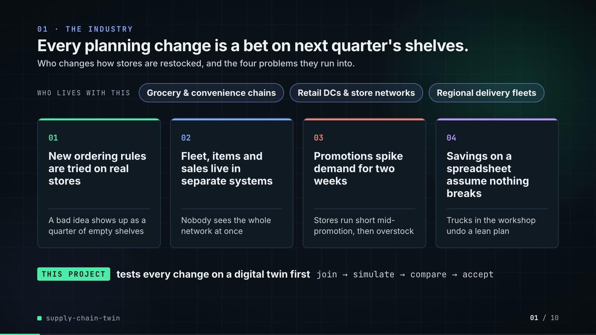

**On-screen text (verbatim)**

> 01 · THE INDUSTRY  
> Every planning change is a bet on next quarter's shelves.  
> Who changes how stores are restocked, and the four problems they run into.  
> WHO LIVES WITH THIS · Grocery & convenience chains · Retail DCs & store networks · Regional delivery fleets  
> 01 New ordering rules are tried on real stores — A bad idea shows up as a quarter of empty shelves  
> 02 Fleet, items and sales live in separate systems — Nobody sees the whole network at once  
> 03 Promotions spike demand for two weeks — Stores run short mid-promotion, then overstock  
> 04 Savings on a spreadsheet assume nothing breaks — Trucks in the workshop undo a lean plan  
> THIS PROJECT tests every change on a digital twin first · join → simulate → compare → accept  

**Figures on this slide**

| ID | Shown | Source · key | Calculation | Check |
|---|---|---|---|---|
| F-01 | 3 industry chips | `author's framing` · - | - | manual |
| F-02 | 4 problem cards | `README 'The problem', 'Why it is hard'` · README lines 9-31 | - | ✓ |

**Assumptions:** A-10

**Illustrative, not data:**

- The whole slide is context; no repo figures.

**To change this slide:** Edit the chips (#ctx-c1..3) and cards (#ctx-k1..4) in compositions/s01-context.html. (project folder `docs/demo/source`).

### Slide 02: This project  
*6.8-12.0 s · composition `compositions/s02-hook.html`*

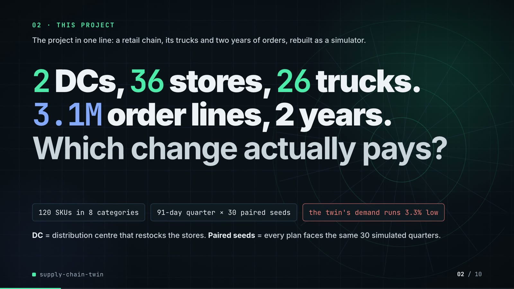

**On-screen text (verbatim)**

> 02 · THIS PROJECT  
> The project in one line: a retail chain, its trucks and two years of orders, rebuilt as a simulator.  
> 2 DCs, 36 stores, 26 trucks. 3.1M order lines, 2 years. Which change actually pays?  
> 120 SKUs in 8 categories · 91-day quarter × 30 paired seeds · the twin's demand runs 3.3% low  
> DC = distribution centre that restocks the stores. Paired seeds = every plan faces the same 30 simulated quarters.  

**Figures on this slide**

| ID | Shown | Source · key | Calculation | Check |
|---|---|---|---|---|
| F-03 | 2 DCs | `data/mms_locations.csv` · distinct dc_id | - | ✓ |
| F-04 | 36 stores | `outputs/data_quality.json` · stores | - | ✓ |
| F-05 | 26 trucks | `outputs/data_quality.json` · trucks_dispatchable | 28 in source - 2 not dispatchable | ✓ |
| F-06 | 3.1M order lines | `outputs/data_quality.json` · order_lines = 3,126,764 | 3,126,764 / 1e6, 1 decimal | ✓ |
| F-07 | 2 years | `src/supply_twin/calendar.py:12` · HISTORY_DAYS = 731 (2024-01-01..2025-12-31) | - | ✓ |
| F-08 | 120 SKUs in 8 categories | `data/mms_items.csv; outputs/data_quality.json` · skus; distinct category | - | ✓ |
| F-09 | 91-day quarter × 30 paired seeds | `src/supply_twin/sim.py:60; outputs/strategy_table.csv` · horizon_days = 91; n_seeds | - | ✓ |
| F-10 | the twin's demand runs 3.3% low / −3.3% demand bias | `outputs/fidelity.json` · bias.twin = -0.0327 | x 100, 1 decimal | ✓ |

**Assumptions:** A-01, A-04, A-06, A-07

**Illustrative, not data:**

- Rings in the background are decoration.

**To change this slide:** Headline spans #hook-l1..l3 and chips #hook-f1..f3 in compositions/s02-hook.html; counts come from outputs/data_quality.json. (project folder `docs/demo/source`).

### Slide 03: How it works (white chapter, slide A)  
*11.7-19.7 s · composition `compositions/explainer.html (CONFIG.blocks, CONFIG.groups, CONFIG.loop)`*

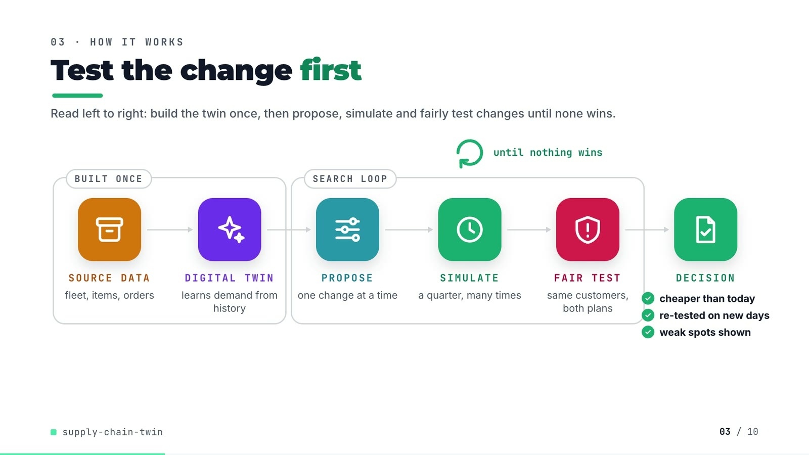

**On-screen text (verbatim)**

> 03 · HOW IT WORKS  
> Test the change first  
> Read left to right: build the twin once, then propose, simulate and fairly test changes until none wins.  
> [BUILT ONCE: SOURCE DATA fleet, items, orders → DIGITAL TWIN learns demand from history] → [SEARCH LOOP: PROPOSE one change at a time → SIMULATE a quarter, many times → FAIR TEST same customers, both plans] → DECISION ✓ cheaper than today ✓ re-tested on new days ✓ weak spots shown  
> until nothing wins (loop over SIMULATE)  

**Figures on this slide**

| ID | Shown | Source · key | Calculation | Check |
|---|---|---|---|---|
| F-11 | SOURCE DATA → DIGITAL TWIN → PROPOSE → SIMULATE → FAIR TEST → DECISION | `src/supply_twin/` · load_sources, build_twin, NeighbourProposer.propose, simulate, Evaluator.compare, search | - | ✓ |
| F-12 | ✓ cheaper than today ✓ re-tested on new days ✓ weak spots shown | `outputs/search_neighbour_promo.json; outputs/search_neighbour_promo_robustness.csv` · holdout.cost_diff < 0; holdout.n_seeds = 30; any robustness row not accepted | - | ✓ |
| F-13 | until nothing wins | `outputs/search_neighbour_promo.csv; agent.py:118-119` · last round has 0 accepted candidates | - | ✓ |

**Assumptions:** A-04, A-08

**Illustrative, not data:**

- Icons and colours are a visual language, not data.
- 'new days' means new random seeds, i.e. new simulated customers.

**To change this slide:** Edit CONFIG in compositions/explainer.html; badge truth comes from the search JSON and robustness CSV (F-12). (project folder `docs/demo/source`).

### Slide 04: The key idea (white chapter, slide B)  
*19.7-27.7 s · composition `compositions/explainer.html (#ex-b ..., IV array)`*

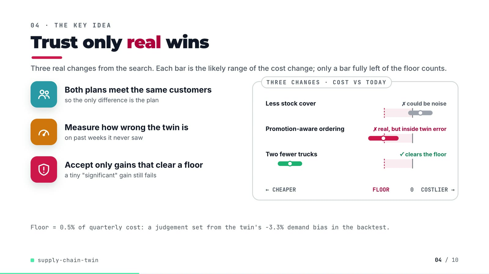

**On-screen text (verbatim)**

> 04 · THE KEY IDEA  
> Trust only real wins  
> Three real changes from the search. Each bar is the likely range of the cost change; only a bar fully left of the floor counts.  
> Both plans meet the same customers — so the only difference is the plan  
> Measure how wrong the twin is — on past weeks it never saw  
> Accept only gains that clear a floor — a tiny "significant" gain still fails  
> THREE CHANGES · COST VS TODAY: Less stock cover ✗ could be noise · Promotion-aware ordering ✗ real, but inside twin error · Two fewer trucks ✓ clears the floor · ← CHEAPER · FLOOR · 0 · COSTLIER →  
> Floor = 0.5% of quarterly cost: a judgement set from the twin's −3.3% demand bias in the backtest.  

**Figures on this slide**

| ID | Shown | Source · key | Calculation | Check |
|---|---|---|---|---|
| F-10 | the twin's demand runs 3.3% low / −3.3% demand bias | `outputs/fidelity.json` · bias.twin = -0.0327 | x 100, 1 decimal | ✓ |
| F-14 | Less stock cover (crosses 0) · Promotion-aware ordering (below 0, above floor) · Two fewer trucks (clears floor) | `outputs/search_neighbour_promo.csv` · round 1 cover=0.5d: +0.139 (-0.078..+0.355); round 3 promo_aware=yes: -0.516 (-0.785..-0.247); round 2 trucks-2: -2.169 (-2.385..-1.954) | cost_diff{,_low,_high} / baseline_cost x 100, 3 decimals; must equal the IV array in compositions/explainer.html | ✓ |
| F-15 | ✗ could be noise · ✗ real, but inside twin error · ✓ clears the floor | `outputs/search_neighbour_promo.csv` · accepted, p_value vs alpha | A: p >= alpha, not accepted; B: p < alpha, not accepted, fill ok; C: accepted | ✓ |
| F-16 | Floor = 0.5% of quarterly cost / cost CI < −0.5% / floor −0.5% | `src/supply_twin/harness.py:34` · MIN_COST_GAIN_SHARE = 0.005 | - | ✓ |

**Assumptions:** A-02, A-03, A-07

**Illustrative, not data:**

- The three intervals are real candidates from the search log (F-14), drawn to scale on a -2.6%..+0.6% axis; 'today' in the pill means the plan in hand at that round, not always the original policy.

**To change this slide:** Markup under #ex-b and the IV array in compositions/explainer.html; F-14 checks the IV values against the CSV. (project folder `docs/demo/source`).

### Slide 05: Architecture  
*27.4-43.4 s · composition `compositions/s03-architecture.html (BANDS, NODES, WIRES, LABELS)`*

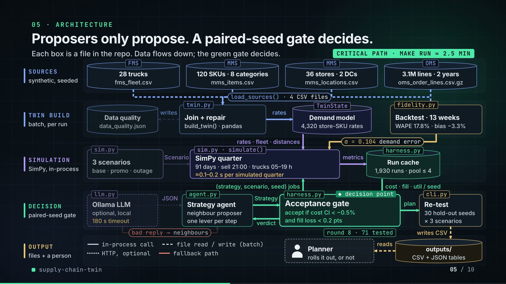

**On-screen text (verbatim)**

> 05 · ARCHITECTURE  
> Proposers only propose. A paired-seed gate decides.  
> Each box is a file in the repo. Data flows down; the green gate decides.  
> SOURCES (synthetic, seeded): FMS 28 trucks fms_fleet.csv · MMS 120 SKUs · 8 categories mms_items.csv · MMS 36 stores · 2 DCs mms_locations.csv · OMS 3.1M lines · 2 years oms_order_lines.csv.gz → load_sources() · 4 CSV files  
> TWIN BUILD (batch, per run): twin.py Join + repair build_twin() · pandas → writes Data quality data_quality.json; → rates TwinState Demand model 4,320 store-SKU rates; fidelity.py Backtest · 13 weeks WAPE 17.8% · bias −3.3%  
> SIMULATION (SimPy, in-process): sim.py 3 scenarios base · promo · outage → Scenario → sim.py · simulate() SimPy quarter 91 days · sell 21:00 · trucks 05–19 h ≈0.1–0.2 s per simulated quarter → metrics → harness.py Run cache 1,930 runs · pool ≤ 4; rates · fleet · distances; σ = 0.104 demand error  
> DECISION (paired-seed gate): llm.py Ollama LLM optional, local 180 s timeout → JSON → agent.py Strategy agent neighbour proposer, one lever per step → Strategy → harness.py Acceptance gate ◆ decision point accept if cost CI < −0.5% and fill loss < 0.2 pts → verdict; (strategy, scenario, seed) jobs; cost · fill · util / seed; bad reply → neighbours; round 8 · 71 tested → plan → cli.py Re-test 30 hold-out seeds × 3 scenarios  
> OUTPUT (files + a person): writes CSV → outputs/ CSV + JSON tables → reads → Planner rolls it out, or not  
> Legend: in-process call · file read / write (batch) · HTTP, optional · fallback path · CRITICAL PATH · MAKE RUN ≈ 2.5 MIN  

**Figures on this slide**

| ID | Shown | Source · key | Calculation | Check |
|---|---|---|---|---|
| F-03 | 2 DCs | `data/mms_locations.csv` · distinct dc_id | - | ✓ |
| F-04 | 36 stores | `outputs/data_quality.json` · stores | - | ✓ |
| F-06 | 3.1M order lines | `outputs/data_quality.json` · order_lines = 3,126,764 | 3,126,764 / 1e6, 1 decimal | ✓ |
| F-07 | 2 years | `src/supply_twin/calendar.py:12` · HISTORY_DAYS = 731 (2024-01-01..2025-12-31) | - | ✓ |
| F-08 | 120 SKUs in 8 categories | `data/mms_items.csv; outputs/data_quality.json` · skus; distinct category | - | ✓ |
| F-16 | Floor = 0.5% of quarterly cost / cost CI < −0.5% / floor −0.5% | `src/supply_twin/harness.py:34` · MIN_COST_GAIN_SHARE = 0.005 | - | ✓ |
| F-17 | twin.py · TwinState · fidelity.py · sim.py · simulate() · harness.py · llm.py · agent.py · cli.py · load_sources() | `src/supply_twin/` · classes and functions | - | ✓ |
| F-18 | 28 trucks | `outputs/data_quality.json` · trucks_in_source | - | ✓ |
| F-19 | 4,320 store-SKU rates | `outputs/data_quality.json` · stores x skus | 36 x 120 = 4,320 | ✓ |
| F-20 | Data quality · data_quality.json | `src/supply_twin/cli.py:49` · _write_json(out / 'data_quality.json') | - | ✓ |
| F-21 | load_sources() · 4 CSV files | `src/supply_twin/twin.py:74-80` · four read_csv calls | - | ✓ |
| F-22 | Backtest · 13 weeks | `outputs/fidelity.json` · holdout_days = 91 | 91 / 7 = 13 | ✓ |
| F-23 | WAPE 17.8% / 17.8% | `outputs/fidelity.json` · wape_store_sku_week.twin | x 100 | ✓ |
| F-24 | σ = 0.104 demand error | `outputs/fidelity.json` · rate_error_sigma | - | ✓ |
| F-25 | bias −3.3% | `outputs/fidelity.json` · bias.twin | x 100 | ✓ |
| F-26 | 91 days · sell 21:00 · trucks 05–19 h | `src/supply_twin/sim.py:27-28, :60` · SHIFT_START, SHIFT_END, SALES_HOUR, horizon_days | - | ✓ |
| F-27 | ≈0.1–0.2 s per simulated quarter | `docs/adr/0001-paired-seeds-and-a-practical-floor-decide-strategies.md:21` · 'runs in about 0.1-0.2 s' | - | ✓ |
| F-28 | 1,930 runs | `outputs/search_neighbour_promo.json` · simulation_runs_total (Evaluator.runs: unique runs executed, including the evaluation table) | - | ✓ |
| F-29 | pool ≤ 4 | `src/supply_twin/harness.py:107` · min(4, os.cpu_count()) | - | ✓ |
| F-30 | 180 s timeout | `src/supply_twin/llm.py:25` · timeout: float = 180 | - | ✓ |
| F-31 | accept if cost CI < −0.5% and fill loss < 0.2 pts | `src/supply_twin/harness.py:29, :34, :76-86` · MIN_COST_GAIN_SHARE, FILL_NON_INFERIORITY | - | ✓ |
| F-32 | 30 hold-out seeds × 3 scenarios | `outputs/search_neighbour_promo.json; outputs/search_neighbour_promo_robustness.csv` · holdout.n_seeds; robustness rows | - | ✓ |
| F-33 | round 8 · 71 tested (counts up through rounds 1-8) | `outputs/search_neighbour_promo.csv / .json` · rounds, candidates_tested, cumulative per round | cumulative tested per round = 8, 17, 26, 35, 44, 53, 62, 71 | ✓ |
| F-34 | make run ≈ 2.5 min / ~2.5 min | `outputs/run_log.txt` · '2:26.26 total' | 146.26 s / 60 = 2.44 min, rounded to the nearest half minute | ✓ |
| F-35 | 3 scenarios · base · promo · outage | `src/supply_twin/sim.py:71-75` · SCENARIOS keys base, promo, fleet_outage | - | ✓ |

- *F-27 note:* Stated in the ADR from the author's runs; not re-timed by this audit.

**Assumptions:** A-01, A-02, A-03, A-04, A-07, A-08

**Illustrative, not data:**

- Packets moving along the edges show execution order, not timing; the search loop is shown as 3 laps for the 8 real rounds while the counter steps through the real cumulative counts.
- The Planner box is the human decision the README describes ('a yes or no they can roll out'); the repo has no UI for it.
- 'Run cache' is the Evaluator's in-memory cache keyed by (strategy, scenario, seed) in harness.py; drawn as a store because it holds results.

**To change this slide:** Edit NODES / WIRES / LABELS in compositions/s03-architecture.html; F-17 checks every named module/function exists. (project folder `docs/demo/source`).

### Slide 06: The system running  
*43.0-58.0 s · composition `compositions/s04-running.html (WALK block injected by tools/inject_sheet.py from assets/search_walk.json)`*

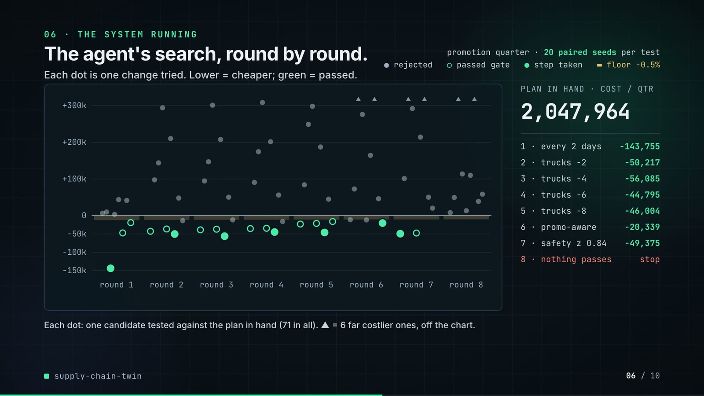

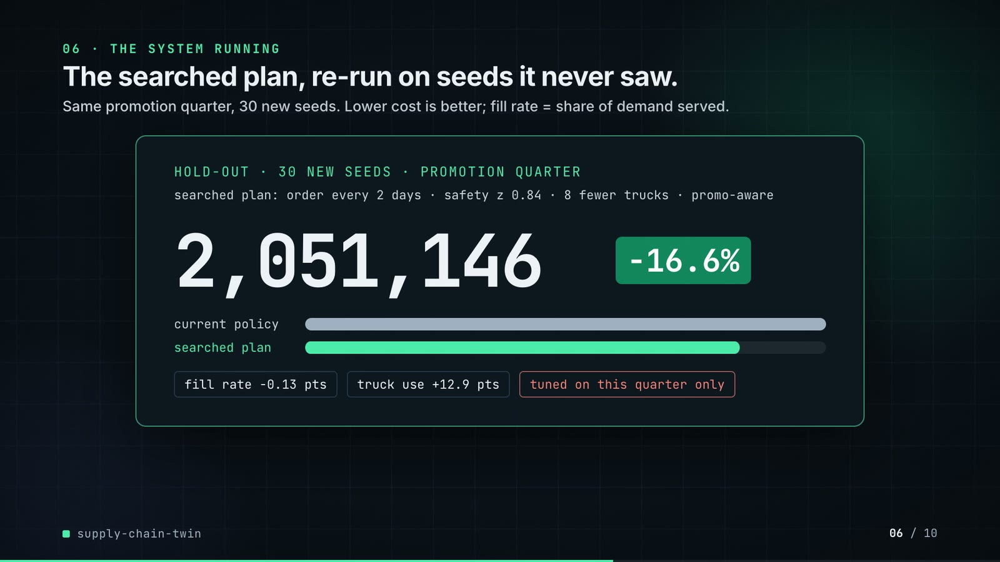

**On-screen text (verbatim)**

> 06 · THE SYSTEM RUNNING  
> The agent's search, round by round.  
> Each dot is one change tried. Lower = cheaper; green = passed.  
> promotion quarter · 20 paired seeds per test · ● rejected ○ passed gate ● step taken ▬ floor −0.5%  
> Chart: cost change vs the plan in hand (−150k..+300k) by round 1..8  
> PLAN IN HAND · COST / QTR 2,458,533 → 2,047,964 · 1 every 2 days −143,755 · 2 trucks −2 −50,217 · 3 trucks −4 −56,085 · 4 trucks −6 −44,795 · 5 trucks −8 −46,004 · 6 promo-aware −20,339 · 7 safety z 0.84 −49,375 · 8 nothing passes stop  
> Each dot: one candidate tested against the plan in hand (71 in all). ▲ = 6 far costlier ones, off the chart.  
> (phase B) The searched plan, re-run on seeds it never saw.  
> Same promotion quarter, 30 new seeds. Lower cost is better; fill rate = share of demand served.  
> HOLD-OUT · 30 NEW SEEDS · PROMOTION QUARTER · searched plan: order every 2 days · safety z 0.84 · 8 fewer trucks · promo-aware · 2,458,347 → 2,051,146 · −16.6% · fill rate −0.13 pts · truck use +12.9 pts · tuned on this quarter only  

**Figures on this slide**

| ID | Shown | Source · key | Calculation | Check |
|---|---|---|---|---|
| F-16 | Floor = 0.5% of quarterly cost / cost CI < −0.5% / floor −0.5% | `src/supply_twin/harness.py:34` · MIN_COST_GAIN_SHARE = 0.005 | - | ✓ |
| F-36 | 71 candidates over 8 rounds; ▲ = 6 far costlier ones | `outputs/search_neighbour_promo.csv → demo assets/search_walk.json, injected into compositions/s04-running.html` · round, cost_diff, accepted, chosen | dot y = cost_diff / 1000 (k); off-chart if > 320k | ✓ |
| F-37 | 1 every 2 days −143,755 · 2 trucks −2 −50,217 · 3 trucks −4 −56,085 · 4 trucks −6 −44,795 · 5 trucks −8 −46,004 · 6 promo-aware −20,339 · 7 safety z 0.84 −49,375 · 8 nothing passes | `outputs/search_neighbour_promo.csv` · rows with chosen = True | rounded to whole units | ✓ |
| F-38 | 2,458,533 (start of the counter) | `outputs/search_neighbour_promo.csv` · round 1 baseline_cost | - | ✓ |
| F-39 | 2,047,964 | `outputs/search_neighbour_promo.csv` · round 8 baseline_cost | - | ✓ |
| F-40 | 20 paired seeds per test | `outputs/search_neighbour_promo.json` · search_seeds | - | ✓ |
| F-41 | 2,458,347 → 2,051,146 | `outputs/search_neighbour_promo.json` · holdout.baseline_cost, holdout.cost_diff | 2,458,346.6 - 407,200.4 = 2,051,146.1 | ✓ |
| F-42 | −16.6% | `outputs/search_neighbour_promo.json` · holdout.cost_diff / holdout.baseline_cost | -407,200.4 / 2,458,346.6 x 100 = -16.56% | ✓ |
| F-43 | fill rate −0.13 pts | `outputs/search_neighbour_promo.json` · holdout.fill_diff_pts | - | ✓ |
| F-44 | truck use +12.9 pts | `outputs/search_neighbour_promo.json` · holdout.util_diff_pts | - | ✓ |
| F-45 | searched plan: order every 2 days · safety z 0.84 · 8 fewer trucks · promo-aware | `outputs/search_neighbour_promo.json` · final (start = z=1.28 review=1d cover=1d trucks+0 promo_aware=no) | review=2d → order every 2 days; z=0.84 → safety z 0.84; trucks-8 → 8 fewer trucks; promo_aware=yes → promo-aware | ✓ |

**Assumptions:** A-02, A-03, A-04, A-05, A-08

**Illustrative, not data:**

- Dots within a round are spread sideways only so they do not overlap; their height is the real cost change.
- The amber strips under zero are the gate's floor for that round (0.5% of the plan in hand).

**To change this slide:** Re-run tools/export_search_walk.py and tools/inject_sheet.py (--name WALK); layout in compositions/s04-running.html. (project folder `docs/demo/source`).

### Slide 07: End-user value (white)  
*57.7-71.7 s · composition `compositions/value.html (SHEET block injected by tools/inject_sheet.py from assets/change_sheet.json)`*

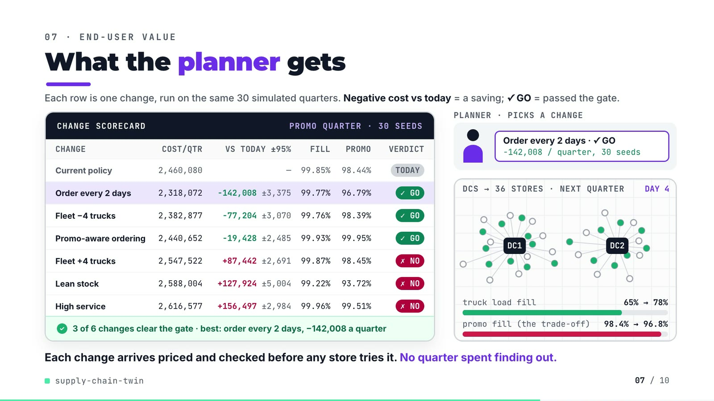

**On-screen text (verbatim)**

> 07 · END-USER VALUE  
> What the planner gets  
> Each row is one change, run on the same 30 simulated quarters. Negative cost vs today = a saving; ✓ GO = passed the gate.  
> CHANGE SCORECARD · PROMO QUARTER · 30 SEEDS — CHANGE, COST/QTR, VS TODAY ±95%, FILL, PROMO, VERDICT  
> Current policy 2,460,080 — 99.85% 98.44% TODAY  
> Order every 2 days 2,318,072 −142,008 ±3,375 99.77% 96.79% ✓ GO  
> Fleet −4 trucks 2,382,877 −77,204 ±3,070 99.76% 98.39% ✓ GO  
> Promo-aware ordering 2,440,652 −19,428 ±2,485 99.93% 99.95% ✓ GO  
> Fleet +4 trucks 2,547,522 +87,442 ±2,691 99.87% 98.45% ✗ NO  
> Lean stock 2,588,004 +127,924 ±5,004 99.22% 93.72% ✗ NO  
> High service 2,616,577 +156,497 ±2,984 99.96% 99.51% ✗ NO  
> ✓ 3 of 6 changes clear the gate · best: order every 2 days, −142,008 a quarter  
> PLANNER · PICKS A CHANGE: Order every 2 days · ✓ GO −142,008 / quarter, 30 seeds  
> DCS → 36 STORES · NEXT QUARTER · DAY 1..4 · truck load fill 65% → 78% · promo fill (the trade-off) 98.4% → 96.8%  
> Each change arrives priced and checked before any store tries it. No quarter spent finding out.  

**Figures on this slide**

| ID | Shown | Source · key | Calculation | Check |
|---|---|---|---|---|
| F-46 | Current policy 2,460,080 … High service 2,616,577 (+156,497 ±2,984) | `demo assets/change_sheet.json (re-run of the repo's evaluation, seeds 1000-1029), injected into compositions/value.html; equals outputs/strategy_table.csv scenario=promo` · total_cost, cost_vs_current, cost_vs_current_ci_half, fill_rate, promo_fill_rate, beats_current | - | ✓ |
| F-47 | 3 of 6 changes clear the gate | `outputs/strategy_table.csv` · scenario=promo, beats_current | - | ✓ |
| F-48 | best: order every 2 days, −142,008 a quarter | `outputs/strategy_table.csv` · scenario=promo, strategy='order every 2 days', cost_vs_current | - | ✓ |
| F-49 | 65% → 78% | `outputs/strategy_table.csv` · scenario=promo, load_fill (0.6461, 0.7760) | x 100, whole percent | ✓ |
| F-50 | 98.4% → 96.8% | `outputs/strategy_table.csv` · scenario=promo, promo_fill_rate (0.9844, 0.9679) | x 100, 1 decimal | ✓ |
| F-51 | PROMO QUARTER · 30 SEEDS / 30 seeds | `demo assets/change_sheet.json` · n_seeds | - | ✓ |
| F-52 | DCs → 36 stores, deliveries on alternating days | `data/mms_locations.csv; src/supply_twin/sim.py:291 ((day + s) % review_days)` · store_id, dc_id, distance_km | radius = 26 px + km x 0.68 px; angle illustrative | ✓ |

**Assumptions:** A-02, A-03, A-04, A-05, A-06

**Illustrative, not data:**

- Planner figure is a placeholder (no real person).
- Store angles around each DC are evenly spaced (the data has no coordinates); each store's distance from its DC is real.
- Purple trips and green dots replay the review stagger of 'order every 2 days' (which half of the stores orders each day); they are not simulated truck movements.
- 'No quarter spent finding out' is framing from the README problem statement, not a measured result.

**To change this slide:** Re-run tools/export_change_sheet.py, then tools/inject_sheet.py (--name SHEET); CONFIG.pick chooses the row the planner hands over. (project folder `docs/demo/source`).

### Slide 08: Results  
*71.4-80.2 s · composition `compositions/s05-results.html (stats array)`*

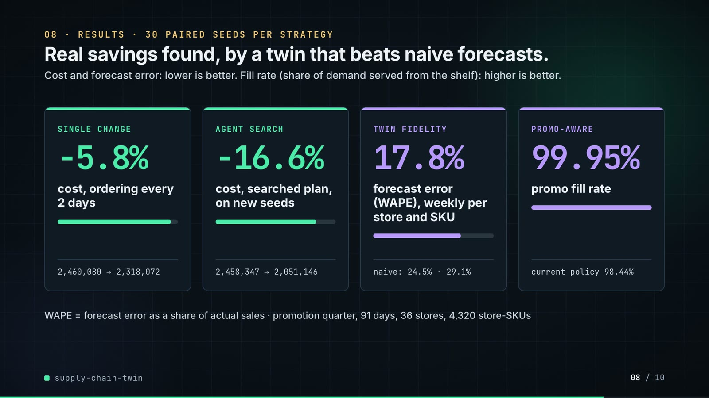

**On-screen text (verbatim)**

> 08 · RESULTS · 30 PAIRED SEEDS PER STRATEGY  
> Real savings found, by a twin that beats naive forecasts.  
> Cost and forecast error: lower is better. Fill rate (share of demand served from the shelf): higher is better.  
> SINGLE CHANGE −5.8% cost, ordering every 2 days · 2,460,080 → 2,318,072  
> AGENT SEARCH −16.6% cost, searched plan, on new seeds · 2,458,347 → 2,051,146  
> TWIN FIDELITY 17.8% forecast error (WAPE), weekly per store and SKU · naive: 24.5% · 29.1%  
> PROMO-AWARE 99.95% promo fill rate · current policy 98.44%  
> WAPE = forecast error as a share of actual sales · promotion quarter, 91 days, 36 stores, 4,320 store-SKUs  

**Figures on this slide**

| ID | Shown | Source · key | Calculation | Check |
|---|---|---|---|---|
| F-04 | 36 stores | `outputs/data_quality.json` · stores | - | ✓ |
| F-19 | 4,320 store-SKU rates | `outputs/data_quality.json` · stores x skus | 36 x 120 = 4,320 | ✓ |
| F-23 | WAPE 17.8% / 17.8% | `outputs/fidelity.json` · wape_store_sku_week.twin | x 100 | ✓ |
| F-41 | 2,458,347 → 2,051,146 | `outputs/search_neighbour_promo.json` · holdout.baseline_cost, holdout.cost_diff | 2,458,346.6 - 407,200.4 = 2,051,146.1 | ✓ |
| F-42 | −16.6% | `outputs/search_neighbour_promo.json` · holdout.cost_diff / holdout.baseline_cost | -407,200.4 / 2,458,346.6 x 100 = -16.56% | ✓ |
| F-53 | −5.8% | `outputs/strategy_table.csv` · scenario=promo, total_cost: 2,318,072 vs 2,460,080 | (2,318,072 / 2,460,080 - 1) x 100 = -5.77% | ✓ |
| F-54 | 2,460,080 → 2,318,072 | `outputs/strategy_table.csv` · scenario=promo, total_cost | - | ✓ |
| F-55 | naive: 24.5% · 29.1% | `outputs/fidelity.json` · wape_store_sku_week.recent_8wk_mean, same_day_last_year | x 100 | ✓ |
| F-56 | 99.95% · current policy 98.44% | `outputs/strategy_table.csv` · scenario=promo, promo_fill_rate | x 100, 2 decimals | ✓ |

**Assumptions:** A-04, A-05, A-07, A-09

**Illustrative, not data:**

- Mini bars under each number are drawn to the ratio after / before (card 3: twin / 8-week mean).

**To change this slide:** The stats array and card text in compositions/s05-results.html. (project folder `docs/demo/source`).

### Slide 09: Lesson and fix  
*79.8-88.8 s · composition `compositions/s06-twist.html`*

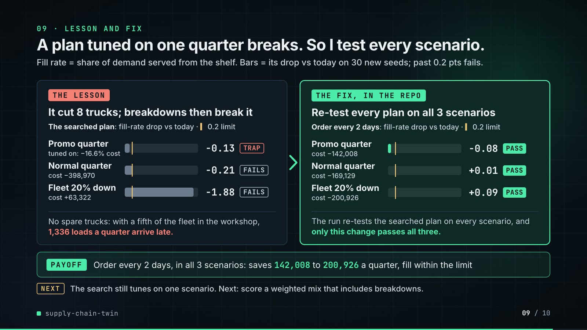

**On-screen text (verbatim)**

> 09 · LESSON AND FIX  
> A plan tuned on one quarter breaks. So I test every scenario.  
> Fill rate = share of demand served from the shelf. Bars = its drop vs today on 30 new seeds; past 0.2 pts fails.  
> THE LESSON · It cut 8 trucks; breakdowns then break it · The searched plan: fill-rate drop vs today · 0.2 limit · Promo quarter (tuned on: −16.6% cost) −0.13 TRAP · Normal quarter (cost −398,970) −0.21 FAILS · Fleet 20% down (cost +63,322) −1.88 FAILS  
> No spare trucks: with a fifth of the fleet in the workshop, 1,336 loads a quarter arrive late.  
> THE FIX, IN THE REPO · Re-test every plan on all 3 scenarios · Order every 2 days: fill-rate drop vs today · 0.2 limit · Promo quarter (cost −142,008) −0.08 PASS · Normal quarter (cost −169,129) +0.01 PASS · Fleet 20% down (cost −200,926) +0.09 PASS  
> The run re-tests the searched plan on every scenario, and only this change passes all three.  
> PAYOFF · Order every 2 days, in all 3 scenarios: saves 142,008 to 200,926 a quarter, fill within the limit  
> NEXT · The search still tunes on one scenario. Next: score a weighted mix that includes breakdowns.  

**Figures on this slide**

| ID | Shown | Source · key | Calculation | Check |
|---|---|---|---|---|
| F-57 | Promo quarter · tuned on: −16.6% cost · −0.13 · TRAP | `outputs/search_neighbour_promo_robustness.csv` · scenario=promo: fill_diff_pts, cost_diff / baseline_cost, accepted | -407,200 / 2,458,347 x 100 = -16.6% | ✓ |
| F-58 | Normal quarter · cost −398,970 · −0.21 · FAILS | `outputs/search_neighbour_promo_robustness.csv` · scenario=base | - | ✓ |
| F-59 | Fleet 20% down · cost +63,322 · −1.88 · FAILS · 1,336 loads a quarter arrive late | `outputs/search_neighbour_promo_robustness.csv` · scenario=fleet_outage | late loads = final_late_loads (mean over 30 hold-out seeds, one 91-day quarter) rounded | ✓ |
| F-60 | 0.2 limit / past 0.2 pts fails | `src/supply_twin/harness.py:29, :79-80` · FILL_NON_INFERIORITY = 0.002 on the lower bound of the fill change | - | ✓ |
| F-61 | Re-test every plan on all 3 scenarios · The run re-tests the searched plan on every scenario | `src/supply_twin/cli.py:65-82 (cmd_evaluate), :157-181 (cmd_robustness), :219-222 (called after the search)` · for ... in SCENARIOS.items(); cmd_robustness(...) | - | ✓ |
| F-65 | Promo quarter cost −142,008 −0.08 PASS · Normal quarter cost −169,129 +0.01 PASS · Fleet 20% down cost −200,926 +0.09 PASS | `outputs/strategy_table.csv` · strategy='order every 2 days', scenario in promo/base/fleet_outage: fill_vs_current_pts, cost_vs_current, beats_current | - | ✓ |
| F-66 | only this change passes all three | `outputs/strategy_table.csv` · beats_current per strategy across the 3 scenarios | strategies with beats_current in every scenario = {order every 2 days} | ✓ |
| F-67 | saves 142,008 to 200,926 a quarter, fill within the limit | `outputs/strategy_table.csv` · strategy='order every 2 days': cost_vs_current min/max; beats_current all | -max(cost_vs_current) .. -min(cost_vs_current) | ✓ |
| F-68 | The search still tunes on one scenario. Next: score a weighted mix that includes breakdowns. | `README 'Known limitations' (first bullet) and 'Insights and learning'` · 'search against a weighted mix of scenarios'; 'neither is implemented' | - | ✓ |

- *F-61 note:* The gate rule itself is unit-tested (tests/test_harness.py::test_acceptance_rule_on_known_cases); cmd_robustness has no unit test of its own, it is exercised by make run, which wrote the robustness CSV.

**Assumptions:** A-02, A-03, A-04, A-05, A-06

**Illustrative, not data:**

- Bars in both panels share one scale: 240 px = a 2.0-point fill drop (120 px per point); a gain (+0.01, +0.09) draws no bar. The amber tick in every track is the 0.2-point limit.
- Colour meaning: the searched plan's bars are neutral grey; coral marks only the TRAP label (the quarter it was tuned on, where it looks best); the fix panel, its bars and PASS chips are mint.
- The left panel uses the 30 hold-out seeds (5000-5029, robustness CSV); the right panel uses the 30 evaluation seeds (1000-1029, strategy table). Neither set was seen by the search (seeds 0-19).
- NEXT is the README's own stated fix for its biggest gap; it is not implemented.

**To change this slide:** Panels #twist-left / #twist-right (bar widths are inline styles on #twist-lb1..3 and #twist-rb1..3), #twist-payoff and #twist-next in compositions/s06-twist.html. (project folder `docs/demo/source`).

### Slide 10: End card  
*88.4-92.8 s · composition `compositions/s07-end.html`*

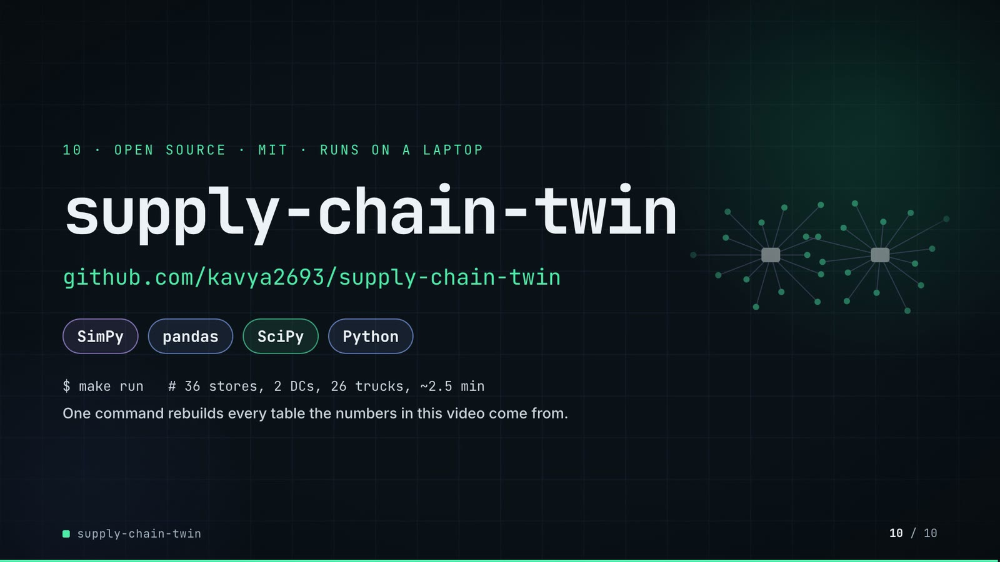

**On-screen text (verbatim)**

> 10 · OPEN SOURCE · MIT · RUNS ON A LAPTOP  
> supply-chain-twin  
> github.com/kavya2693/supply-chain-twin  
> SimPy · pandas · SciPy · Python  
> $ make run   # 36 stores, 2 DCs, 26 trucks, ~2.5 min  
> One command rebuilds every table the numbers in this video come from.  

**Figures on this slide**

| ID | Shown | Source · key | Calculation | Check |
|---|---|---|---|---|
| F-03 | 2 DCs | `data/mms_locations.csv` · distinct dc_id | - | ✓ |
| F-04 | 36 stores | `outputs/data_quality.json` · stores | - | ✓ |
| F-05 | 26 trucks | `outputs/data_quality.json` · trucks_dispatchable | 28 in source - 2 not dispatchable | ✓ |
| F-34 | make run ≈ 2.5 min / ~2.5 min | `outputs/run_log.txt` · '2:26.26 total' | 146.26 s / 60 = 2.44 min, rounded to the nearest half minute | ✓ |
| F-62 | MIT | `LICENSE line 1` · - | - | ✓ |
| F-63 | SimPy · pandas · SciPy · Python | `pyproject.toml dependencies` · simpy, pandas, scipy | - | ✓ |
| F-64 | $ make run | `Makefile` · run target | - | ✓ |

**Assumptions:** A-09

**Illustrative, not data:**

- The faded network on the right is decoration drawn from geometry, not data.

**To change this slide:** Text in compositions/s07-end.html. (project folder `docs/demo/source`).

## 5. Change-impact matrix

| Input / assumption | Affected figures | Affected slides | Files to edit | Commands to re-run |
|---|---|---|---|---|
| A-01: All data is synthetic, written by a seeded generator (seed 7) shaped like the three source systems: 28 trucks, 120 SKUs, 36 stores, 2 DCs, two years of daily order lines with 4% annual growth, holidays and category promotions | all figures | 01, 02, 03, 04, 05, 06, 07, 08, 09, 10 | `scripts/generate_data.py` | `make data; make run` |
| A-02: Acceptance floor: a change is accepted only if the whole 95% interval of its total-cost change lies below -0 | F-14, F-15, F-16, F-31, F-36, F-37, F-39, F-46, F-47, F-48, F-65, F-66, F-67 | 04, 05, 06, 07, 09 | `src/supply_twin/harness.py:34` | `make run; export_search_walk.py + export_change_sheet.py + inject_sheet.py` |
| A-03: Fill non-inferiority: a change may lose at most 0 | F-31, F-36, F-37, F-46, F-47, F-57, F-58, F-59, F-60, F-65, F-66, F-67 | 05, 06, 07, 09 | `src/supply_twin/harness.py:29` | `make run` |
| A-04: Seeds: the search uses 20 seeds (0-19) with a Bonferroni split of alpha per round; the evaluation table uses 30 seeds (1000-1029); the searched plan is confirmed on 30 hold-out seeds (5000-5029) the search never saw | F-09, F-12, F-32, F-40, F-41, F-42, F-43, F-44, F-51 | 02, 03, 05, 06, 07, 08 | `src/supply_twin/cli.py:189-191` | `make run` |
| A-05: Cost constants are stated, not estimated: holding 25% a year, backroom overflow 1 | F-14, F-36, F-37, F-39, F-41, F-42, F-46, F-48, F-53, F-54, F-57, F-58, F-59 | 04, 06, 07, 08, 09 | `src/supply_twin/sim.py:29-34` | `make run; export_search_walk.py + export_change_sheet.py + inject_sheet.py` |
| A-06: Scenarios: a 91-day horizon; the promotion quarter puts beverages and snacks on a 14-day promotion from day 35; the outage scenario takes 20% of each DC's trucks out of service for the whole quarter | F-09, F-26, F-35, F-59, F-61, F-65, F-66 | 02, 05, 09 | `src/supply_twin/sim.py:60-74` | `make run` |
| A-07: Simulated demand carries the store-SKU error spread measured in the 13-week backtest (sigma 0 | F-10, F-23, F-24, F-25, F-56 | 02, 04, 05, 08 | `src/supply_twin/fidelity.py` | `make run` |
| A-08: The neighbour proposer moves one lever one grid step at a time (z, review days, cover days, fleet size, promotion awareness); the search stops when a round accepts nothing (here after 8 rounds) | F-13, F-33, F-36, F-37, F-45 | 03, 05, 06 | `src/supply_twin/agent.py:23-29` | `make run` |
| A-09: Video rounding: money to whole units with thousands separators, percentages to 1 decimal (fill rates to 2), points to 2 decimals; '3 | F-06, F-10, F-14, F-24, F-34, F-42, F-49, F-50, F-53, F-56 | 02, 04, 05, 06, 07, 08, 10 | `the composition file named on each slide` | `hyperframes render` |
| A-10: Slide 01 (industry, everyday problems) is general retail-planning knowledge used as context | F-01, F-02 | 01 | `compositions/s01-context.html` | `hyperframes render` |

## 6. Known differences and caveats

- The whole dataset is synthetic and the twin is estimated from data produced by the same family of assumptions it then simulates, so fidelity (17.8% WAPE) is an upper bound on what a real extract would give (README 'The data').
- −16.6% (slides 06, 08) is the searched plan on the quarter it was tuned on; it fails the fill limit on a normal quarter and fails on cost and fill with 20% of the fleet down (slide 09).
- '1,930 runs' is the number of unique simulations executed when the search finished, including the evaluation table; the robustness re-test ran more afterwards.
- '≈0.1–0.2 s per simulated quarter' is quoted from ADR-0001, not re-timed by this audit.
- 'make run ≈ 2.5 min' is the author's run_log (2:26); the README says about 3 minutes on 4 cores.
- Slide 04's three intervals compare each candidate with the plan in hand at that round of the search, not always with the original policy.
- The language-model proposer is drawn in the architecture but was only tested with stubbed replies (README 'Known limitations'); every number in the video comes from the neighbour proposer.
- Slide 01 statements are general retail-planning knowledge (A-10).
- Slide 09's fix is the re-test and the per-scenario scorecard the repo runs; the search itself still optimises one scenario at a time, so a plan that holds under breakdowns is found by the evaluation table, not by the search (README 'Known limitations'). The left panel (hold-out seeds 5000-5029) and right panel (evaluation seeds 1000-1029) use different seed sets.
- Slide 09 drops the README's other 'what didn't win' items, which the README still reports: the high-service policy has the best fill rate and loses 156,497 (also on slide 07), and the language-model proposer has no live measurement (it timed out on the author's machine).

## Appendix: environment

- Commit: `a4f50f5289cc8c298a8e842f8aadd139c609579c`
- Python: 3.11.7
- simpy 4.1.2
- pandas 3.0.6
- numpy 2.4.6
- scipy 1.17.1
- Profile / seeds: data_generator=7, search_seeds=0-19, evaluation_seeds=1000-1029, holdout_seeds=5000-5029
- Run time: outputs/run_log.txt: make run 2:26.26 total (about 2.4 min) on the author's laptop; README says about 3 minutes on 4 cores
